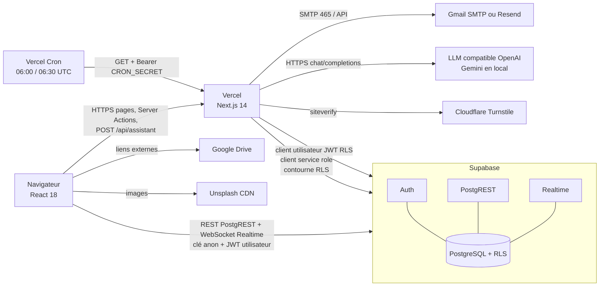
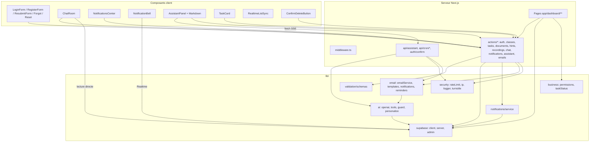
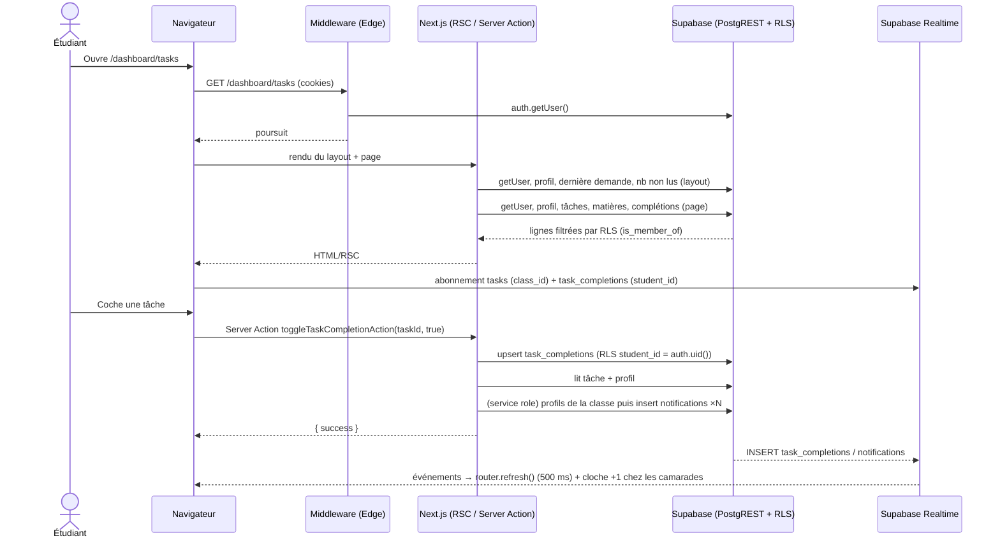
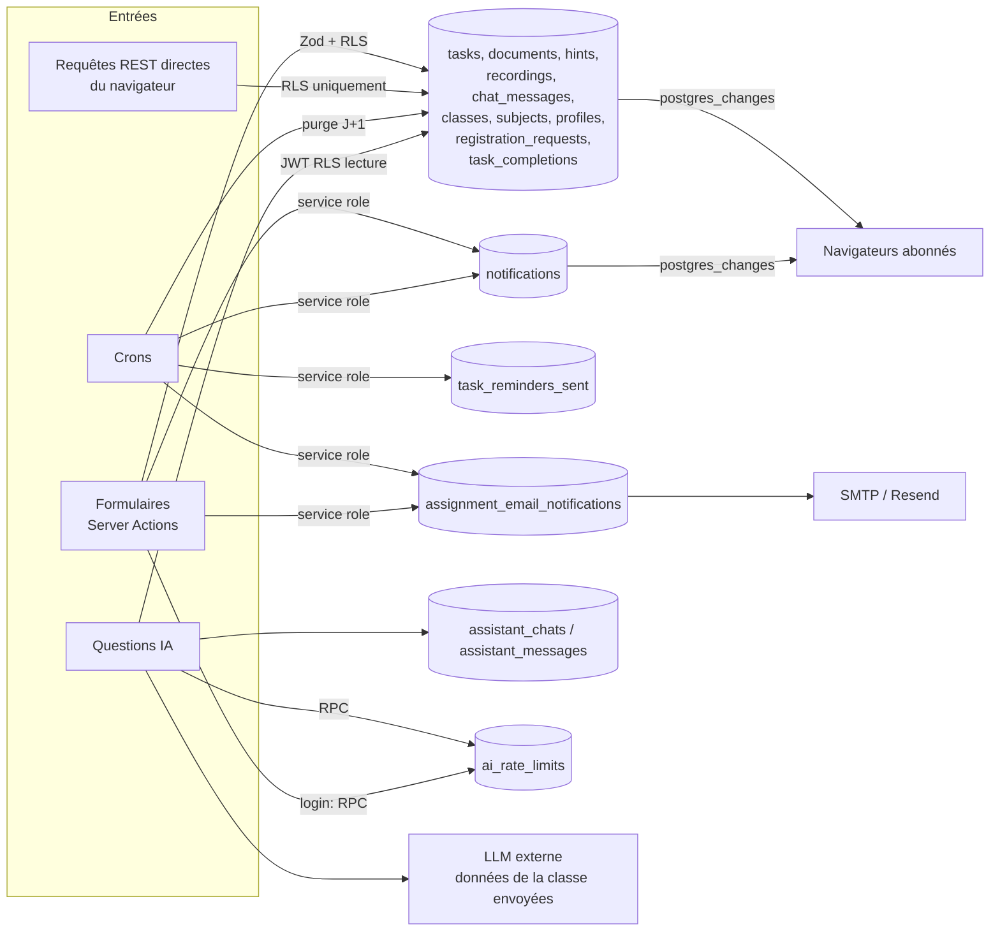
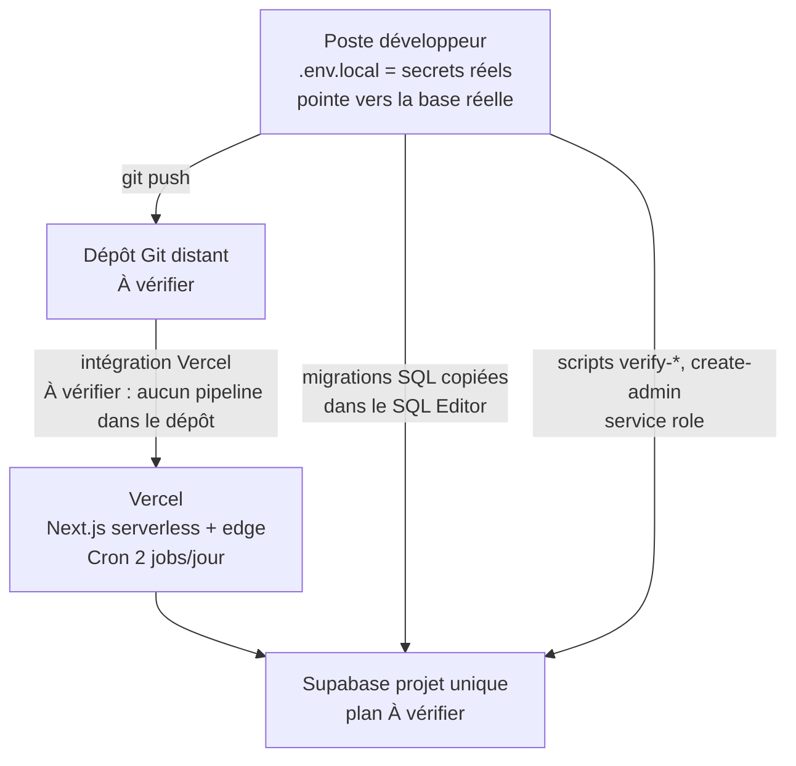

# 02 — Architecture technique actuelle (Rapport C)

> Ce document décrit le système **observé dans le code**. Les éléments d'hébergement non visibles dans le dépôt (plan Vercel, plan Supabase, réglages du tableau de bord Supabase) sont signalés **À vérifier**.

## 1. Vue d'ensemble

ClassePulse est un **monolithe Next.js 14 (App Router)** déployé (selon `vercel.json` et le README) sur **Vercel**, qui s'appuie sur **Supabase** comme backend managé. Il n'existe **aucun serveur persistant propre** : toute la logique serveur s'exécute dans des fonctions serverless/edge Vercel ou dans PostgreSQL (RLS, triggers, fonctions).

La particularité structurante : **deux chemins d'accès aux données coexistent**.

1. **Chemin serveur** : Server Components et Server Actions Next.js appellent Supabase avec le JWT de l'utilisateur (cookies) → la RLS s'applique. Certaines actions utilisent en plus le **client service role** (contourne la RLS) pour les notifications, emails, lectures d'emails et inscriptions.
2. **Chemin navigateur direct** : le navigateur détient la clé anon + le JWT de l'utilisateur et interroge **directement PostgREST et Realtime** (chat, pagination, notifications, cloche). N'importe quel utilisateur peut donc appeler l'API REST Supabase **sans passer par Next.js** : la **RLS PostgreSQL est la seule véritable frontière de sécurité** pour ce chemin.

### Composants et rôles

| Composant | Rôle | Emplacement |
|---|---|---|
| Middleware (Edge) | Rafraîchit la session Supabase ; protège `/dashboard/**` ; renvoie les connectés hors des pages d'auth | `middleware.ts` |
| Server Components | Rendu des pages ; lectures via client utilisateur (et service role sur admin/délégué/emails) | `app/**/page.tsx` |
| Server Actions | Toutes les mutations ; validation Zod ; RLS ; effets secondaires (notifications, emails) via service role | `actions/*.ts`, actions inline |
| Route Handlers | Assistant IA (SSE), crons, échange de lien email | `app/api/**`, `app/auth/confirm` |
| Composants client | Formulaires, chat, notifications, assistant, Realtime | `components/**` |
| Supabase Auth | Comptes email/mot de passe, sessions JWT, emails de récupération | managé |
| PostgreSQL + RLS | Données, autorisation, intégrité, triggers, rate limit (`check_ai_rate_limit`) | `supabase/schema.sql`, migrations |
| PostgREST | API REST générée, appelée par le serveur **et** le navigateur | managé |
| Supabase Realtime | Diffusion `postgres_changes` (chat, notifications, listes) | managé |
| Vercel Cron | Déclenche rappels (06:00 UTC) et purge (06:30 UTC) | `vercel.json` |
| SMTP / Resend | Emails transactionnels | `lib/email/emailService.ts` |
| LLM (API compatible OpenAI) | Assistant + personnalisation d'emails | `lib/ai/*` |
| Google Drive | Hébergement des fichiers (liens seulement) | externe |
| Cloudflare Turnstile | CAPTCHA connexion (inopérant, P-006) | `lib/security/turnstile.ts` |

### Points uniques de défaillance visibles

- **Supabase** : base, authentification, temps réel et rate limiting. Si la RPC de rate limit échoue, **plus aucune connexion n'est possible** (fail-closed, `lib/security/rateLimit.ts:74-77`).
- **Vercel Cron** : seul déclencheur des rappels et purges ; aucune reprise si une exécution échoue (les rappels FAILED ne sont pas retentés car le jour J change).
- **Clé service role** : unique clé omnipotente, présente dans l'environnement de toutes les fonctions serveur.
- **Compte SMTP unique** (Gmail en local) : quotas d'envoi du fournisseur (**À vérifier**).

## 2. Diagrammes

### 2.1 Architecture globale



### 2.2 Composants applicatifs



### 2.3 Séquence — parcours principal (étudiant : consulter et terminer un devoir)



### 2.4 Authentification (inscription, validation, connexion)

```mermaid
sequenceDiagram
  actor V as Visiteur
  participant N as Next.js
  participant AU as Supabase Auth
  participant DB as PostgreSQL
  actor D as Délégué / Admin
  V->>N: registerAction(formulaire)
  N->>DB: (service role) profil avec cet email ?
  N->>AU: signUp(email, mdp)
  N->>DB: (service role) insert profiles STUDENT, class_id NULL
  N->>DB: (service role) insert registration_requests PENDING
  N-->>V: redirect /pending
  D->>N: decideRegistrationAction(id, ACCEPTED)
  N->>DB: (JWT délégué) select demande ; update status (RLS)
  N->>DB: (service role) profiles.class_id = classe demandée
  N->>DB: (service role) notification REGISTRATION_ACCEPTED
  N->>N: email d'acceptation (SMTP) + trace
  V->>N: loginAction(email, mdp)
  N->>DB: (service role) RPC check_ai_rate_limit ×2 (IP, compte)
  N->>AU: signInWithPassword
  AU-->>N: session (cookies httpOnly gérés par @supabase/ssr)
  N-->>V: redirect /dashboard → layout vérifie la dernière demande
```

### 2.5 Flux de données principaux



Point d'attention : les réponses d'outils de l'assistant (titres de devoirs, descriptions, liens Drive, notifications) sont **transmises au fournisseur LLM** — c'est un transfert de données vers un tiers à documenter (`05-securite.md`).

### 2.6 Déploiement observé



Aucun environnement de préproduction n'est décrit ; le précédent audit (historique Git) indique que les tests de sécurité ont été menés **sur la base de production**.

## 3. Technologies et dépendances

| Technologie | Usage | Version | Indispensable | Verrou fournisseur | Observations |
|---|---|---|---|---|---|
| TypeScript | Tout le code | ^5.5.4 | Oui | — | strict + `noUncheckedIndexedAccess`, mais 22 usages de `any` (app, components, lib, actions) et 19 assertions `user!`/`profile!` dans `app/` |
| Next.js (App Router, Server Actions, Middleware) | Framework fullstack | 14.2.35 | Oui (actuel) | Moyen (Server Actions, conventions Vercel) | Branche 14.x en fin de vie, **critique** à `npm audit` ; correctif = 16.x |
| React | UI | 18.3.1 | Oui | — | — |
| Tailwind CSS | Styles | ^3.4.14 | Facultatif | — | Thème via variables CSS ; `darkMode: "class"` |
| lucide-react | Icônes | ^0.454 | Facultatif | — | — |
| Zod | Validation serveur | 3.25.76 | Oui | — | Pas de validation partagée client |
| @supabase/supabase-js | Données, Auth, Realtime | 2.55.0 épinglé | Oui | **Fort** | Épinglé pour compatibilité avec `@supabase/ssr` 0.5.2 (ancien audit) |
| @supabase/ssr | Cookies de session | 0.5.2 | Oui | Fort | API `get/set/remove` dépréciée dans les versions récentes |
| PostgreSQL (Supabase) | Données, RLS, triggers, fonctions | non déterminable | Oui | Faible (SQL standard) mais **`auth.uid()`, `auth.users`, rôles `anon/authenticated/service_role`, publication `supabase_realtime`** sont spécifiques Supabase | — |
| Supabase Auth | Comptes | managé | Oui | **Fort** | Hashs bcrypt dans `auth.users` (exportables — **À vérifier**) |
| Supabase Realtime | Temps réel | managé | Moyen | Fort | `postgres_changes` (coûteux à l'échelle) |
| Vercel | Hébergement, Cron | plan À vérifier | Remplaçable | Moyen | Plan gratuit : crons quotidiens seulement (cohérent avec les commits « correction vercel ») |
| nodemailer | SMTP | 9.0.5 | Oui (emails) | Faible | **7 avis de sécurité** (`npm audit`) |
| resend | Repli email | 4.8.0 | Facultatif | Moyen | — |
| API compatible OpenAI | LLM | modèle configurable | Facultatif | Faible (format standard) | Gemini via `OPENAI_BASE_URL` en local |
| Cloudflare Turnstile | CAPTCHA | — | Facultatif | Faible | Script client absent |
| Vitest | Tests | 4.1.10 | Dev | — | 149 tests unitaires |
| ESLint (`next/core-web-vitals`) | Lint | 8.57.1 | Dev | — | ESLint 8 en fin de vie |
| Outils absents | monitoring (Sentry…), analytics, file d'attente, cache, ORM, outil de migration, Docker, CI | — | — | — | — |

Aucun ORM : accès aux données par le query builder Supabase, typé par `types/database.types.ts` **écrit à la main** (`Insert: Partial<Row>` → aucune vérification des champs obligatoires à la compilation).

## 4. Frontières et couplages notables

- **Autorisation répartie sur 4 couches** non synchronisées : UI (affichage conditionnel par `role` en dur), Server Actions (contrôles partiels), helpers `lib/business/permissions.ts` (majoritairement inutilisés), **RLS** (référence réelle). Les écarts entre ces couches sont la cause de P-020/P-021.
- **Le service role est utilisé dans le chemin de requête utilisateur** (inscription, décision, notifications, pages admin/délégué). Toute action qui l'emploie doit faire ses propres contrôles d'autorisation — ce n'est pas systématique.
- **Couplage fort à Supabase** dans tout le code (142 appels `.from("table")` répartis dans 31 fichiers : pages, actions, lib, composants), sans couche d'accès aux données.
