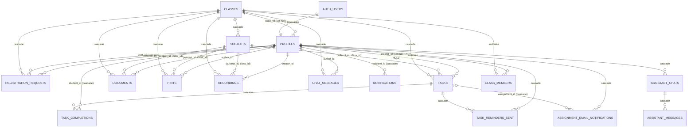

# 04 — Modèle de données et base de données (Rapport E)

> **Statut : schéma déduit du dépôt** (`supabase/schema.sql` + 15 migrations). La base réelle n'a **pas** été interrogée. Des écarts entre bases sont probables (voir § 5). Aucune donnée réelle n'est reproduite ici.

## 1. Inventaire des objets

| Type | Objets |
|---|---|
| Extensions | `pgcrypto` (`gen_random_uuid()`) |
| Enums | `user_role` (STUDENT, DELEGATE, ADMIN) ; `registration_status` (PENDING, ACCEPTED, REJECTED) ; `task_type` (EXERCISE, TP, ASSIGNMENT, RESEARCH, PROJECT, OTHER) ; `hint_type` (DEVOIR, EXAMEN, CONTROLE, TP, PROJET, AUTRE) ; `reminder_kind` (J3, J1) ; `notification_type` (15 valeurs dans `schema.sql`, + `MESSAGE_RECEIVED`, `NEW_CONVERSATION` sur les bases migrées par 0002) |
| Tables (17) | classes, profiles, class_members, subjects, registration_requests, tasks, task_completions, task_reminders_sent, documents, hints, recordings, chat_messages, notifications, assignment_email_notifications, assistant_chats, assistant_messages, ai_rate_limits |
| Tables supprimées | conversations, conversation_participants, direct_messages, message_reads (messagerie privée créée en 0002, supprimée en 0006) |
| Fonctions | `current_profile_role`, `is_approved_member`, `current_profile_class_id`, `is_admin`, `is_delegate_of`, `is_member_of` (toutes `SECURITY DEFINER`, `search_path = public`) ; `set_updated_at` ; `prevent_self_privilege_escalation` ; `notifications_immutable_fields` ; `check_ai_rate_limit` |
| Triggers | `trg_profiles_updated`, `trg_tasks_updated` (updated_at) ; `trg_prevent_escalation` (profiles) ; `trg_notifications_readonly` |
| Vues | aucune |
| Publication Realtime | notifications, tasks, documents, hints, recordings, task_completions, chat_messages |

## 2. Entités

Notation : **PK** clé primaire, **FK** clé étrangère, **NN** non nul, **U** unique, *def* valeur par défaut.

### classes — classe/promotion
| Colonne | Type | Contraintes |
|---|---|---|
| id | uuid | PK, *def* gen_random_uuid() |
| name | text | NN |
| level | text | NN |
| academic_year | text | NN (format `AAAA-AAAA` imposé seulement par Zod) |
| created_at | timestamptz | NN, *def* now() |
Contraintes : U(name, academic_year). RLS : lecture **publique** (y compris anonyme) ; insert admin ; delete admin si aucun profil rattaché ; **aucune policy UPDATE** (classe non modifiable).

### profiles — miroir applicatif de `auth.users`
| Colonne | Type | Contraintes |
|---|---|---|
| id | uuid | PK, FK → auth.users(id) **ON DELETE CASCADE** |
| first_name, last_name | text | NN |
| email | text | NN, U ; index unique `lower(email)` (0008) — **donnée personnelle** |
| role | user_role | NN, *def* STUDENT |
| class_id | uuid | FK → classes(id) ON DELETE SET NULL ; NULL tant que non accepté ; NULL pour un ADMIN global |
| last_seen_at | timestamptz | jamais écrit par l'application |
| created_at, updated_at | timestamptz | NN ; trigger updated_at |
Index : class_id, role, last_seen_at. RLS : lecture de soi / admin / membres de sa classe ; update de soi ou admin ; **aucun INSERT client**. Privilèges : SELECT de la colonne `email` retiré aux rôles clients (0009). **UPDATE non restreint par colonne** : un utilisateur peut modifier son `email`, ses horodatages, son nom (P-022).

### class_members — **non utilisée**
id PK ; class_id FK → classes CASCADE ; user_id FK → profiles CASCADE ; joined_at ; U(class_id, user_id). Aucune lecture/écriture dans le code.

### subjects — matières
id PK ; class_id FK → classes CASCADE (NN) ; name NN ; code ; created_at. U(class_id, name) ; U(id, class_id) (cible des FK composites, 0011). RLS : lecture membres ; écriture admin uniquement. Pas d'UI de modification/suppression.

### registration_requests — demandes d'inscription (historisées)
| Colonne | Type | Contraintes |
|---|---|---|
| id | uuid | PK |
| user_id | uuid | NN, FK → profiles CASCADE |
| class_id | uuid | NN, FK → classes CASCADE |
| status | registration_status | NN, *def* PENDING |
| decided_by | uuid | FK → profiles (**NO ACTION**) |
| decided_at | timestamptz | |
| created_at | timestamptz | NN |
Index : class_id, status ; unique partiel `user_id WHERE status='PENDING'`. RLS : lecture soi/admin/délégué de la classe ; **INSERT si `user_id = auth.uid()` sans contrainte sur `status`, `decided_by`, `decided_at`** (P-020) ; UPDATE admin/délégué sans restriction de colonnes (P-033).

### tasks — devoirs/tâches
| Colonne | Type | Contraintes |
|---|---|---|
| id | uuid | PK |
| class_id | uuid | NN, FK → classes CASCADE |
| subject_id | uuid | NN, FK → subjects CASCADE ; FK composite (subject_id, class_id) → subjects(id, class_id) CASCADE |
| creator_id | uuid | **NN** + FK → profiles **ON DELETE SET NULL** (contradiction, P-007) |
| title | text | NN (3-150 via Zod) |
| description | text | (≤ 3000 via Zod) |
| type | task_type | NN, *def* OTHER |
| due_date | timestamptz | NN |
| attachment_link | text | |
| is_expired | boolean | NN, *def* false |
| created_at, updated_at | timestamptz | trigger updated_at |
Index : class_id, subject_id, creator_id, due_date. RLS : lecture membres ; écriture (ALL) admin ou délégué de la classe.

### task_completions — complétion individuelle
id PK ; task_id FK → tasks CASCADE ; student_id FK → profiles CASCADE ; completed_at *def* now() ; U(task_id, student_id). RLS : lecture soi ou membres de la classe de la tâche ; écriture : `USING` soi + membre, mais `WITH CHECK` seulement `student_id = auth.uid()` (P-032).

### task_reminders_sent — anti-doublon des rappels in-app
id PK ; task_id FK CASCADE ; student_id FK CASCADE ; kind reminder_kind ; sent_at ; U(task_id, student_id, kind). RLS : admin uniquement (écrit par le service role).

### documents / hints / recordings — ressources (liens Drive)
Structure commune : id PK ; class_id NN FK CASCADE ; subject_id NN FK CASCADE + FK composite ; title NN ; drive_url NN ; auteur (`author_id` pour documents/hints, `creator_id` pour recordings) **NN + ON DELETE SET NULL** ; created_at.
Spécifique : documents.description ; hints.year (text NN), hints.type (hint_type) ; recordings.date (date NN), recordings.description.
RLS : lecture membres ; insert membre + auteur = soi (documents, hints) ; recordings écriture admin/délégué ; delete documents/hints : auteur, délégué, admin. **Pas de policy UPDATE** pour documents et hints.

### chat_messages
id PK ; class_id NN FK CASCADE ; author_id **NN + ON DELETE SET NULL** ; content text NN CHECK 1-2000 ; is_announcement boolean NN *def* false ; created_at. Index (class_id, created_at desc) ; `idx_chat_announcements` (définition divergente selon les migrations, § 5). RLS : lecture membres ; insert membre + auteur = soi + annonce réservée (0010) ; delete auteur/délégué/admin ; pas d'UPDATE.

### notifications
| Colonne | Type | Contraintes |
|---|---|---|
| id | uuid | PK |
| recipient_id | uuid | NN FK → profiles CASCADE |
| type | notification_type | NN |
| title, message | text | NN |
| read_at | timestamptz | seule colonne modifiable par le client |
| created_at | timestamptz | NN |
| entity_type | text | (task, document, hint, recording, chat, profile) |
| entity_id | uuid | **sans FK** (peut pointer vers une entité supprimée) |
| link | text | chemin interne |
| category | text | NN *def* 'system' (pas de CHECK) |
Index : (recipient_id, created_at desc), partiel non lus, (recipient_id, read_at, created_at), (recipient_id, category, created_at), entity_id. RLS : lecture destinataire/admin ; update destinataire (read_at seulement — privilèges + trigger, 0013) ; insert admin (en pratique service role).

### assignment_email_notifications — journal des emails
id PK ; assignment_id FK → tasks **CASCADE** (NULL pour l'email d'acceptation) ; user_id NN FK → profiles CASCADE ; email text NN CHECK regex ; notification_type text CHECK (AUTHENTICATION_APPROVED, ASSIGNMENT_3_DAYS, ASSIGNMENT_1_DAY) ; status text CHECK (PENDING, SENT, FAILED) *def* PENDING ; sent_at ; error_message ; created_at. Uniques partiels : un SENT par (assignment, user, type) et un SENT par (user, type) sans assignment. RLS : lecture admin. **Le journal disparaît avec la tâche purgée** (CASCADE).

### assistant_chats / assistant_messages
assistant_chats : id PK ; user_id NN FK → profiles CASCADE ; title *def* 'Nouveau chat' ; created_at, updated_at (mis à jour par l'application, pas de trigger).
assistant_messages : id PK ; chat_id NN FK → assistant_chats CASCADE ; role text CHECK (user, assistant) ; content NN ; actions jsonb *def* `[]` ; created_at. Index (chat_id, created_at). RLS : propriétaire uniquement ; pas d'UPDATE/DELETE de message (suppression par cascade du chat).

### ai_rate_limits — compteurs de limitation (IA **et** authentification)
bucket_key text, window_start timestamptz, request_count int ; PK(bucket_key, window_start). RLS activée sans policy (inaccessible en direct). Accès via `check_ai_rate_limit(text,int,int)` `SECURITY DEFINER`, **exécutable par `authenticated`** (P-023). Les clés contiennent des emails en clair (`auth:login:acc:<email>`) et des identifiants utilisateurs. Nettoyage probabiliste (1 % des appels) des fenêtres de plus d'un jour.

## 3. Diagramme entité-relation

`notifications.entity_id` et `ai_rate_limits.bucket_key` sont des références **logiques** sans FK.

## 4. Migrations et évolution du schéma

| N° | Objet | Nature | Remarque |
|---|---|---|---|
| 0001 | Journal des emails | Ajout | — |
| 0002 | Notifications enrichies, messagerie privée, assistant, Realtime | Ajout | Ajoute 2 valeurs d'enum jamais retirées |
| 0003 | `last_seen_at`, Realtime conversations | Ajout | Colonne jamais utilisée |
| 0004 | `is_announcement`, index partiel | Ajout | Index renommé/redéfini en 0005 |
| 0005 | Accès PENDING bloqué, revoke email (inefficace), notifications_insert admin | Sécurité | Revoke colonne inopérant (corrigé en 0009) |
| 0006 | Suppression de la messagerie privée | **Destructif** | Données de messages privés supprimées |
| 0007 | Publication Realtime du chat | Config | — |
| 0008 | Dédoublonnage des profils + unicité `lower(email)` | **Destructif** (DELETE de profils, cascades) | Exécuté une fois |
| 0009 | S1 : email non lisible par les clients | Sécurité | Contrôle `DO` bruyant |
| 0010 | S2 : annonces réservées | Sécurité | — |
| 0011 | S3 : FK composites | Intégrité | Pré-vol bruyant |
| 0012 | S4 : pas d'ADMIN automatique | Sécurité | — |
| 0013 | S6 : notifications immuables | Sécurité | — |
| 0014 | S8 : droits de suppression alignés | Sécurité | — |
| 0015 | S9 : rate limiting en base | Ajout | Smoke-test intégré |

**Processus** : migrations copiées-collées dans le SQL Editor Supabase (`README.md` § Migrations), sans outil (Supabase CLI, Flyway, Prisma…) ni table de suivi : **impossible de savoir, depuis le dépôt, quelles migrations sont appliquées en production**. `schema.sql` est maintenu en parallèle comme « état cible » pour une base neuve.

## 5. Écarts et dérives probables entre bases

| Écart | Base créée par `schema.sql` | Base historique migrée | Effet |
|---|---|---|---|
| `notification_type` | 15 valeurs | + `MESSAGE_RECEIVED`, `NEW_CONVERSATION` | Types morts possibles |
| `idx_chat_announcements` | `(class_id, is_announcement, created_at desc)` | Partiel `(class_id, created_at desc) WHERE is_announcement` (0004), conservé car `IF NOT EXISTS` | Plans d'exécution différents |
| Contrainte `subjects` unique (id, class_id) | Nom auto-généré par la définition inline | `subjects_id_class_id_key` (0011) | Même nom en pratique (convention PostgreSQL) — **À vérifier** |
| Grants profiles/notifications | appliqués dans `schema.sql` | appliqués par 0009/0013 si exécutées | Sécurité dépendante de l'exécution manuelle |
| Types TypeScript | `class_members`, `ai_rate_limits` absents ; `Insert = Partial<Row>` | — | Aucune détection de dérive à la compilation |

## 6. Problèmes de cohérence et risques

| Réf. | Constat | Preuve | Conséquence |
|---|---|---|---|
| P-007 | Colonnes d'auteur **NOT NULL** avec **ON DELETE SET NULL** | `schema.sql:147, 204, 226, 248, 265` | Supprimer un utilisateur (ou son compte Auth, qui cascade sur `profiles`) **échoue** dès qu'il a créé un contenu ; `decided_by` (NO ACTION) bloque aussi la suppression des délégués/admins ayant statué |
| P-054 | Purge définitive des tâches à J+1 | `api/cron/cleanup/route.ts:30-34` | Perte des complétions, rappels et journaux d'emails ; statistiques non historisées |
| — | Une seule classe par utilisateur (`profiles.class_id`) ; `class_members` prévue mais morte | `schema.sql:72, 93-102` | Pas de multi-classe, pas d'historique d'appartenance |
| — | Pas de contrainte sur `notifications.category`, `entity_type` | `schema.sql:698-701` | Valeurs libres |
| — | `hints.year`, `classes.academic_year` en `text` | `schema.sql:57, 223` | Formats validés seulement côté application |
| — | `profiles.email` dupliqué depuis `auth.users` sans synchronisation | `actions/auth.ts:79-86` | Divergence possible (aggravée par P-022) |
| — | `assistant_chats.updated_at` mis à jour par l'application | `route.ts:182` | Peut diverger |
| — | Pas de suppression logique, pas d'audit des modifications | — | Aucune traçabilité des modifications/suppressions (sauf décisions d'inscription) |

## 7. Données sensibles et conservation

| Donnée | Où | Sensibilité | Conservation observée |
|---|---|---|---|
| Email | profiles, assignment_email_notifications, clés de ai_rate_limits | Personnelle | Indéfinie ; ai_rate_limits ≈ 1 jour (probabiliste) |
| Nom, prénom | profiles | Personnelle | Indéfinie |
| Mot de passe (haché) | auth.users (Supabase) | Secret | Gérée par Supabase |
| Messages de chat | chat_messages | Personnelle (contenu libre) | Indéfinie |
| Conversations IA | assistant_messages | Personnelle (contenu libre), **transmise au LLM** | Indéfinie (suppression manuelle par l'utilisateur) |
| Adresses IP | non stockées en base ; anonymisées dans les logs ; présentes en clair dans les clés `auth:login:ip:<ip>` | Personnelle | ≈ 1 jour |
| Activité (complétions, notifications) | task_completions, notifications | Personnelle | Complétions supprimées avec la tâche ; notifications indéfinies |

Aucune politique de conservation, d'export ou de suppression de compte n'est implémentée.

## 8. Identification des utilisateurs

Identifiant unique : UUID de `auth.users`, réutilisé comme PK de `profiles` et comme clé de toutes les relations. Les UUID sont visibles par les membres d'une même classe (lecture de `profiles.id`). L'email est l'identifiant de connexion (normalisé en minuscules par Zod, unicité insensible à la casse en base).
