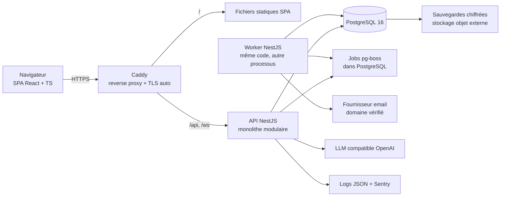

# 09 — Préparer la reconstruction : exigences et architecture cible (Rapport N)

> **Ce document est une proposition argumentée**, distincte de la description de l'existant (documents 01 à 08 et 12). Rien de ce qui suit n'existe aujourd'hui dans le dépôt. Les choix restent soumis aux décisions listées au § 7.

## 1. Exigences à préserver (continuité du produit)

### 1.1 Fonctionnalités confirmées à reprendre

| Domaine | Fonctionnalités (IDs de `01`) |
|---|---|
| Identité | Inscription avec choix de classe (F-002), connexion (F-003), déconnexion (F-004), récupération de mot de passe (F-005…F-007), page d'attente (F-008) |
| Admission | Validation/refus par délégué ou admin (F-011), email d'acceptation (F-012), historique des demandes, resoumission après refus (F-009, **à réparer**) |
| Organisation | Classes (F-013/F-014), matières (F-015), délégués (F-016), tableaux de bord (F-017…F-019) |
| Tâches | Création/modification/suppression (F-020…F-022), complétion individuelle (F-023), suivi par élève (F-024), indicateurs d'urgence (F-025), expiration (F-026), rappels J‑3/J‑1 in-app + email (F-027) |
| Ressources | Documents, hints, cours enregistrés : ajout et suppression avec leurs règles de droits (F-028…F-033) |
| Communication | Chat de classe temps réel, pagination, modération, annonces (F-034…F-037) |
| Notifications | Notifications in-app typées et catégorisées, centre de notifications, compteur temps réel (F-038…F-041) |
| Assistant | Assistant IA en lecture seule, borné à la classe et au périmètre, avec historique et quotas (F-042…F-045, F-052) |
| Pilotage | Statistiques délégué/admin (F-046), suivi des emails et email de test (F-047, F-048) |
| Confort | Thème clair/sombre, squelettes, confirmations de suppression (F-049, F-053, F-054) |

### 1.2 Règles métier à préserver (IDs `R-xx` de `01` § B.4)

À reprendre telles quelles : R-01, R-02, R-03, R-05 (en corrigeant la faille), R-06, R-07, R-08, R-09, R-15, R-17, R-18, R-19, R-20, R-21, R-23.
À **trancher** avant reprise : R-04 (caractère définitif d'une décision), R-10 (Drive uniquement ?), R-11 (politique de mot de passe), R-12 (seuils), R-13 (règle d'urgence unique), R-14 (purge vs archivage), R-16 (email de refus ?), R-22 (périmètre de l'assistant).

### 1.3 Éléments incomplets ou à décider

Présence en ligne, recherche, renommage des conversations IA, `class_members`/multi-classes, gestion des membres, édition des ressources, export et suppression de compte, upload de fichiers, préférences de notification.

### 1.4 Données à préserver

Comptes (avec hashs de mots de passe si exportables), profils, classes, matières, demandes d'inscription (historique), tâches non purgées et complétions, documents, hints, cours, messages et annonces, notifications, journal des emails, conversations IA (**décision** : migrer ou non). Détail : `10` § 3.

## 2. Contraintes et moteurs de décision

| Moteur | Constat d'audit | Conséquence pour la cible |
|---|---|---|
| Sécurité | Les failles majeures viennent d'une **autorisation dispersée** et d'une **base exposée au navigateur** (P-020…P-023, P-043, P-070, P-071) | Une **couche d'autorisation unique côté serveur** ; la base n'est plus accessible depuis le navigateur |
| Maintenabilité | Logique dans les pages, types manuels, schéma en double (P-040, P-041, P-044) | Modules métier, accès aux données typé et généré, migrations versionnées |
| Exploitation | Migrations manuelles, pas de sauvegarde démontrée, pas de monitoring (P-060…P-063) | CI/CD, migrations automatisées, sauvegardes testées, observabilité de base |
| Réduction du serverless | Crons Vercel sans reprise, fonctions à durée limitée (assistant, rappels) | Processus serveur persistant + file de jobs |
| Échelle | Quelques classes d'étudiants (ordre de grandeur : centaines à quelques milliers d'utilisateurs — **à confirmer**) | **Monolithe** ; ni microservices, ni Kubernetes, ni cache distribué au départ |
| Budget | README : « 0 FCFA, 100 % free tier » | Le coût d'un hébergement persistant est une **décision du propriétaire** (§ 7) |
| Équipe | Un contributeur, contexte académique | Technologies répandues, documentation abondante, peu de pièces mobiles |

## 3. Options comparées

| Critère | **A. Durcir l'existant** (Next.js + Supabase) | **B. Next.js fullstack auto-hébergé** + PostgreSQL + ORM + auth applicative | **C. Monolithe modulaire** React (Vite) + NestJS + PostgreSQL |
|---|---|---|---|
| Effort | Faible (corrections P0/P1) | Moyen | Élevé |
| Corrige la cause racine (autorisation unique, base non exposée) | Partiellement (reste RLS + actions) | Oui si toutes les données passent par une couche service | Oui, par construction (guards + services) |
| API REST documentée (OpenAPI) | Non | Possible mais secondaire (Route Handlers) | Native (`@nestjs/swagger`) |
| Dépendance au serverless | Forte (Vercel + Supabase) | Faible (serveur Node + Docker) | Faible |
| Verrou fournisseur | Fort | Faible | Faible |
| Nombre de déployables | 0 (managé) | 1 | 2 (API + front statique), ou 1 si l'API sert le front |
| Complexité opérationnelle | Très faible | Moyenne | Moyenne |
| Courbe d'apprentissage | Connue | Moyenne (RSC/Server Actions restent subtils, pièges déjà rencontrés) | Moyenne (NestJS structurant mais verbeux) |
| Réutilisation du code actuel | Totale | Élevée (pages, composants, Zod) | Moyenne (composants UI, schémas Zod, logique pure, SQL) |
| Clients futurs (mobile, intégrations) | Via Supabase | Moyen | Bon |
| SEO de la landing | Bon | Bon | Landing à servir en statique (suffisant) |
| Coût d'hébergement | 0 (free tier) | VPS ou PaaS payant (ordre de grandeur : quelques euros à ~15 €/mois — **à vérifier**) | Idem B |

### Évaluation de l'option demandée : React + TypeScript / NestJS + TypeScript / PostgreSQL

- **Besoin couvert** : séparation nette front/back, autorisation centralisée (guards, policies), modules métier explicites, API documentée, jobs et WebSocket dans le même processus.
- **Avantages** : structure imposée (modules, injection de dépendances) adaptée à une équipe qui veut des pratiques professionnelles ; écosystème mûr (validation, Swagger, tests, WebSockets, planification) ; TypeScript partagé avec le front.
- **Inconvénients** : plus de code d'infrastructure (DTO, modules) ; deux applications à versionner ; gestion des cookies/CORS ; perte du SSR (sans impact réel ici : seule la landing est publique).
- **Risques** : sur-ingénierie si l'on reproduit des patterns d'entreprise inutiles (CQRS, microservices) ; dérive du périmètre pendant la réécriture.
- **Critères d'adoption** : volonté d'exposer une API stable (application mobile ou intégrations envisagées), équipe prête à maintenir un serveur, budget d'hébergement accepté.

### Recommandation

1. **Immédiatement, quelle que soit la suite** : appliquer les correctifs P0 de l'option A sur la v1 en production (P-020, P-021, P-022, P-023, P-027, P-001, P-028), car la reconstruction prendra des mois et la v1 manipule des données personnelles.
2. **Pour la v2 : option C (monolithe modulaire NestJS + PostgreSQL + SPA React)** si les critères d'adoption ci-dessus sont confirmés. Si le propriétaire ne prévoit ni API publique ni client mobile et veut minimiser l'effort, **l'option B** est l'alternative raisonnable — à condition d'imposer la même règle structurante : *aucun accès aux données hors d'une couche de services qui applique l'autorisation*.

Ne sont **pas** recommandés au démarrage : microservices, Kubernetes, Redis, bus de messages externe, GraphQL. Critères qui justifieraient de les introduire plus tard : plusieurs instances de l'API (→ adaptateur Redis pour WebSocket), files de jobs à fort débit, équipes multiples.

## 4. Architecture cible proposée (option C)

### 4.1 Découpage en modules (backend)

| Module | Responsabilités | Reprend |
|---|---|---|
| `auth` | Inscription, connexion, sessions, vérification d'email, réinitialisation, rate limiting | F-002…F-008 |
| `users` | Profil, rôle global, suppression/anonymisation | — |
| `classes` | Classes, matières | F-013…F-015 |
| `enrollments` | Demandes, décisions, appartenances, délégués | F-009, F-011, F-016 |
| `tasks` | Tâches, complétions, échéances, archivage | F-020…F-026 |
| `resources` | Documents, hints, cours enregistrés, validation des liens | F-028…F-033 |
| `chat` | Messages, annonces, modération, passerelle WebSocket | F-034…F-037 |
| `notifications` | Création, diffusion, centre, préférences | F-038…F-041 |
| `mail` | Gabarits, envoi, journal, anti-doublon | F-012, F-027, F-047, F-048 |
| `assistant` | Conversations, outils en lecture **via les services** (jamais la base directement), quotas | F-042…F-045 |
| `stats` | Agrégats | F-046 |
| `jobs` | Planification (rappels, archivage, nettoyage) | F-026, F-027 |
| `authorization` (transverse) | Politiques `peut(acteur, action, ressource)` testées une à une | R-01…R-09, R-18 |

### 4.2 Choix techniques, justification et alternatives

| Brique | Proposition | Besoin | Avantages | Inconvénients / risques | Alternatives | Critère d'adoption |
|---|---|---|---|---|---|---|
| Frontend | React + TypeScript + Vite, React Router, TanStack Query, Tailwind (reprise des composants `ui/`) | SPA authentifiée | Simple à servir, réutilise l'UI | Pas de SSR | Next.js (option B) | API séparée retenue |
| Contrat | Schémas Zod partagés dans un paquet `shared` (monorepo pnpm) + OpenAPI généré | Validation unique front/back | Fin des duplications | Discipline de versionnement | class-validator | — |
| Backend | NestJS (adaptateur Express ou Fastify) | Modules, guards, DI, Swagger, WebSockets, planification | Structure, écosystème | Verbosité | Fastify seul, Hono, AdonisJS | Équipe prête à adopter NestJS |
| Accès aux données | **Drizzle ORM** ou **Kysely** + migrations SQL versionnées | Typage généré, SQL proche du schéma actuel (index partiels, FK composites, triggers) | Garde les contraintes existantes | Moins « magique » que Prisma | Prisma (index partiels via SQL brut) | Préférence d'équipe |
| Base | PostgreSQL 16 | Reprise directe du schéma | Aucun changement de moteur | Exploitation à assurer | Garder Supabase **comme simple PostgreSQL managé**, Neon | Budget/compétences d'exploitation |
| Autorisation | Service de politiques central + guards NestJS ; RLS **optionnelle** en défense en profondeur | Cause racine des failles | Testable unitairement | — | RLS seule (actuel) | — |
| Authentification | Sessions côté serveur (cookie `HttpOnly`, `Secure`, `SameSite=Lax`, table `sessions`), Argon2id, import des hashs bcrypt Supabase avec re-hachage à la connexion | Supprimer la dépendance Supabase Auth | Contrôle total, révocation de session | À implémenter avec soin (reset, vérification d'email) | Garder Supabase Auth (verrou), bibliothèque d'auth éprouvée | Faisabilité de l'export des hashs (**à vérifier**) |
| Jobs | **pg-boss** (file + cron dans PostgreSQL) dans un processus worker | Rappels, emails, archivage avec reprise | Pas de Redis, transactions avec la base | Charge sur PostgreSQL (négligeable à cette échelle) | BullMQ + Redis | Volumétrie élevée → BullMQ |
| Temps réel | Passerelle WebSocket NestJS (salons par classe/utilisateur), authentifiée par la session | Chat, notifications | Événements ciblés au lieu de `router.refresh()` | Une instance (sinon adaptateur Redis / `LISTEN/NOTIFY`) | SSE pour les notifications seules | — |
| Cache | Aucun au départ | — | — | — | Redis | Mesures de charge |
| Fichiers | Liens Drive conservés (validation stricte) ; option d'upload S3-compatible plus tard | P-053 | — | — | Cloudflare R2, MinIO | Décision produit |
| Emails | nodemailer + fournisseur transactionnel avec domaine vérifié (SPF, DKIM, DMARC) | Délivrabilité | — | Coût éventuel | Gmail SMTP (actuel, déconseillé en production) | — |
| LLM | Adaptateur OpenAI-compatible conservé, vrai streaming, quotas par utilisateur approuvé, journal de coût | F-042 | Portabilité | Données envoyées à un tiers | — | Décision de conformité |
| Conteneurs | Dockerfiles API/worker/front, Docker Compose | Reproductibilité | Environnements identiques | — | PaaS (Render, Railway, Fly.io) | — |
| Reverse proxy / HTTPS | Caddy (TLS automatique Let's Encrypt) | Exposition | Simple | — | Nginx + certbot, Traefik | — |
| CI/CD | GitHub Actions : lint, typage, tests unitaires, tests d'intégration (PostgreSQL éphémère), audit des dépendances, build d'images, migration puis déploiement | P-047, P-060 | — | — | GitLab CI | — |
| Observabilité | Logs JSON (pino) avec ID de requête, Sentry (erreurs front et back), sonde de disponibilité, alerte sur jobs en échec | P-061 | — | — | Grafana/Loki | — |
| Sauvegardes | `pg_dump` quotidien chiffré vers un stockage externe + rétention 30 jours ; test de restauration mensuel ; PITR si base managée | P-062 | — | — | Sauvegardes du fournisseur managé | — |

## 5. Modèle de données cible (évolutions motivées)

| Évolution | Problème actuel traité | Remarque |
|---|---|---|
| Table `users` (email `citext` unique, `password_hash`, `email_verified_at`, `global_role` ∈ {USER, ADMIN}, `deleted_at`) + `sessions`, `password_reset_tokens`, `email_verification_tokens` (jetons hachés, usage unique, expiration) | Dépendance à `auth.users`, email dupliqué et modifiable (P-022) | Conserver les UUID existants |
| Table `class_memberships` (`user_id`, `class_id`, `class_role` ∈ {STUDENT, DELEGATE}, `status`, `joined_at`, `left_at`) | `profiles.class_id` unique, `class_members` morte, délégué sans classe (P-011), pas de retrait de membre (P-050), multi-classe (P-055) | Remplace `profiles.class_id` ; reprend les données de `profiles` + `registration_requests` |
| `enrollment_requests` (ex-`registration_requests`) avec transitions contrôlées (PENDING → ACCEPTED/REJECTED) | P-020, P-033 | Historique conservé |
| Colonnes d'auteur **nullables** + affichage « utilisateur supprimé », ou anonymisation des utilisateurs | P-007 | Droit à l'effacement |
| Tâches : `archived_at` au lieu de la suppression physique ; journal d'emails sans cascade sur la tâche | P-054 | Décision R-14 |
| Contraintes `CHECK` sur `notifications.category`, `entity_type` ; FK ou référence polymorphe documentée | Valeurs libres | — |
| Table `audit_log` (acteur, action, entité, avant/après, date) pour les décisions, rôles, suppressions | Aucune traçabilité | — |
| Rate limiting en mémoire (instance unique) ou table interne non exposée | P-023, P-074 | — |
| Conserver : FK composites matière/classe, unicités partielles (une demande PENDING, un email SENT), immuabilité des notifications, contraintes de longueur | Acquis de la v1 | — |
| Ressources : conserver 3 tables (`documents`, `hints`, `recordings`) **ou** fusionner en `resources(kind, …)` | Duplication de code | **Décision** — ne rien supprimer sans mapping |

## 6. Exigences transverses dès le départ

**Sécurité** : autorisation centralisée testée (matrice rôle × classe × statut), validation de toutes les entrées (y compris identifiants), URL strictement validées (`https:` + domaines exacts), en-têtes de sécurité (CSP, HSTS, frame-ancestors, Referrer-Policy), CSRF (SameSite + jeton ou vérification d'origine), rate limiting par IP et par compte sans verrouillage du propriétaire, secrets hors dépôt (variables chiffrées de la CI, rotation documentée), dépendances surveillées (Dependabot/Renovate), journal d'audit, politique de conservation et de suppression des données, revue des transferts au fournisseur LLM.

**Tests** : stratégie de `07` § I.5 ; CI bloquante.

**Sauvegardes** : quotidiennes, chiffrées, hors site, restauration testée.

**Monitoring** : erreurs, latence, disponibilité, échecs de jobs et d'emails, coût LLM.

**Déploiement** : environnements `dev` / `staging` / `prod` séparés, migrations automatiques et réversibles (ou « expand/contract »), déploiement reproductible par image, retour arrière documenté.

## 7. Décisions à prendre avant de coder

| # | Décision | Options | Impact |
|---|---|---|---|
| D-01 | Option d'architecture | A / B / C | Tout le plan |
| D-02 | Budget d'hébergement mensuel | 0 (free tier) / quelques €/mois / plus | Faisabilité de B/C, choix VPS vs PaaS vs managé |
| D-03 | Fournisseur d'identité | Auth applicative / Supabase Auth conservé / bibliothèque tierce | Migration des comptes |
| D-04 | Conservation des tâches | Purge J+1 (actuel) / archivage | Statistiques, journaux |
| D-05 | Multi-classe par utilisateur | Non (actuel) / oui | Modèle d'appartenance |
| D-06 | Stockage de fichiers | Liens Drive uniquement / upload | Coût, modération, RGPD |
| D-07 | Périmètre de l'assistant IA et fournisseur | Garde-fou strict / aide pédagogique ; fournisseur gratuit / payant | Conformité, coût, cohérence UX |
| D-08 | Migration des conversations IA et du chat | Oui / non / partielle | Volume de migration |
| D-09 | Règles d'admission | Décision définitive ou révisable ; email de refus | R-04, R-16 |
| D-10 | Cible utilisateurs et volumétrie | Une école / plusieurs établissements (multi-tenant ?) | Modèle de données (tenant), dimensionnement |
| D-11 | Langues | Français uniquement / i18n | UI |
| D-12 | Conformité | Loi applicable (ex. protection des données au Sénégal), consentements, mentions légales | Politique de données |
