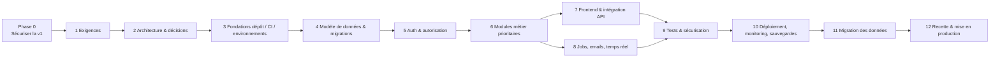

# 10 — Plan de reconstruction, réduction du serverless et migration (Rapports N § 16.3/16.6 et O)

> Plan proposé sur la base de l'option C (`09`). Il reste valable pour l'option B en remplaçant « API NestJS » par « couche de services Next.js ». Aucune durée n'est donnée : elle dépend de la taille de l'équipe (décision D-02/D-10).

## 1. Ordre recommandé

## 2. Phases

### Phase 0 — Sécuriser la v1 en production (parallèle au cadrage)
- **Objectif** : réduire le risque pendant la reconstruction.
- **Contenu** : corriger P-020 (WITH CHECK `status = 'PENDING'`, contrôle de rôle et des lignes modifiées), P-021, P-022 (privilèges UPDATE par colonne sur `profiles`), P-023 (retirer `EXECUTE` à `authenticated`), P-027 (validation d'URL stricte), P-001 (redirection), P-025, montée de `nodemailer` ; vérifier sur la production que 0009-0015 sont appliquées ; **sauvegarde manuelle de la base** ; créer une base de test séparée pour les scripts `verify-*`.
- **Livrables** : migration SQL 0016, correctifs d'actions, rapport de vérification.
- **Critères d'acceptation** : les scénarios négatifs de `05` échouent (refus) sur une base de test ; aucun effet de bord sur refus.
- **Risques** : régression de l'admission → tester les parcours accepter/refuser.
- **Passage** : correctifs P0 en production + sauvegarde vérifiée.

### Phase 1 — Clarification des exigences
- **Objectif** : figer le périmètre v2.
- **Contenu** : valider la matrice `01` § B.5 (garder / corriger / abandonner chaque F-xxx), trancher les règles R-xx à décider, répondre aux questions du § 6 et aux décisions D-01…D-12 (`09` § 7).
- **Livrables** : backlog priorisé (MVP v2 = parité fonctionnelle corrigée), critères d'acceptation par fonctionnalité.
- **Critères** : chaque F-xxx a un statut et un critère de recette.
- **Passage** : décisions D-01, D-02, D-03, D-04 signées.

### Phase 2 — Architecture et décisions techniques
- **Contenu** : ADR (Architecture Decision Records) pour framework, ORM, auth, jobs, temps réel, hébergement ; modèle d'autorisation (matrice action × rôle × portée) ; contrat OpenAPI initial ; modèle de données cible.
- **Livrables** : dossier `docs/adr/`, schéma cible, matrice d'autorisation.
- **Critères** : chaque règle R-xx est rattachée à une politique d'autorisation ou une contrainte.
- **Risques** : sur-conception → s'en tenir au monolithe.

### Phase 3 — Fondations du dépôt et des environnements
- **Contenu** : monorepo (`apps/api`, `apps/web`, `packages/shared`), configuration validée au démarrage, linters/formatage, Docker Compose de développement (PostgreSQL local), CI (lint, typage, tests, audit), environnements dev/staging/prod.
- **Critères** : un nouveau développeur lance l'application localement en une commande sans accès à la production.
- **Passage** : CI verte sur une application « hello world » déployée en staging.

### Phase 4 — Modèle de données et migrations
- **Contenu** : schéma v2 (`09` § 5) en migrations versionnées, contraintes reprises (FK composites, uniques partiels), seed de développement, génération des types.
- **Tests** : migrations rejouées sur base vide et sur un **dump anonymisé** de la v1.
- **Critères** : toutes les règles d'intégrité de la v1 sont présentes ou explicitement abandonnées.

### Phase 5 — Authentification et permissions
- **Contenu** : inscription, vérification d'email, connexion, sessions, déconnexion, réinitialisation, rate limiting ; service d'autorisation + guards ; import des comptes (hashs bcrypt).
- **Tests** : matrice d'autorisation complète en intégration (cas autorisés et refusés), tests de rate limit sans verrouillage du propriétaire.
- **Critères** : aucun endpoint sans décorateur d'autorisation (vérifié par un test qui parcourt les routes).
- **Risques** : export des hashs impossible → plan B réinitialisation par email.

### Phase 6 — Modules métier prioritaires
Ordre : `classes` → `enrollments` (admission, délégués) → `tasks` → `resources` → `notifications` → `chat` → `stats` → `assistant`.
- **Critères** : parité avec les fiches F-xxx retenues, règles R-xx testées, OpenAPI à jour.

### Phase 7 — Frontend et intégration API
- **Contenu** : reprise des composants `components/ui`, écrans de `01` § B.1 avec corrections UX de `12` § 10, gestion d'erreurs et retours systématiques, accessibilité.
- **Tests** : composants critiques, E2E des parcours principaux.

### Phase 8 — Notifications, jobs et temps réel
- **Contenu** : pg-boss (rappels J‑3/J‑1 idempotents avec reprise des échecs, archivage, envoi d'emails asynchrone, diffusion de notifications), passerelle WebSocket (chat, cloche), emails avec domaine vérifié.
- **Critères** : exécution double d'un job sans doublon ; reprise après panne SMTP ; rappels corrects au changement de jour dans le fuseau configuré.

### Phase 9 — Tests et sécurisation
- **Contenu** : revue de sécurité ciblée (scénarios de `05`), en-têtes, CSP, audit des dépendances, tests de charge du cron et du chat.
- **Critères** : aucune vulnérabilité haute ouverte ; scénarios P-020…P-035 couverts par des tests de non-régression.

### Phase 10 — Déploiement, monitoring, sauvegardes
- **Contenu** : images Docker, Caddy/TLS, déploiement staging/prod, logs, Sentry, alertes, sauvegardes chiffrées, **test de restauration**.
- **Critères** : restauration réussie sur un environnement vierge ; alerte reçue lors d'un échec simulé de job.

### Phase 11 — Migration des données (voir § 3)
### Phase 12 — Recette et mise en production
- **Contenu** : recette fonctionnelle sur la matrice F-xxx, pilote avec une classe, bascule, période d'observation, décommissionnement de la v1.
- **Critères** : toutes les F-xxx « à conserver » validées ; aucun incident bloquant pendant la période pilote.

## 3. Stratégie de migration des données

| Étape | Contenu |
|---|---|
| 1. Inventaire | Volumétrie par table (requêtes de comptage en lecture sur la v1), données orphelines (profils sans demande, comptes Auth sans profil, demandes sur classes supprimées), versions de migrations appliquées |
| 2. Sauvegarde préalable | Dump complet chiffré de la v1 (schéma `public` **et** `auth`), conservé hors ligne ; vérification de restaurabilité |
| 3. Correspondance | Tableau ci-dessous |
| 4. Transformation | Scripts idempotents, exécutés d'abord sur une **copie anonymisée** puis sur une copie complète en staging |
| 5. Identifiants | Conserver les UUID (aucune réécriture des clés) ; les liens externes et notifications restent valides |
| 6. Vérification d'intégrité | Comptages par table avant/après, sommes de contrôle sur colonnes clés, contraintes actives, échantillonnage manuel, test de connexion de comptes réels (avec leur accord) |
| 7. Bascule | Gel des écritures v1 (mode maintenance) → dump final → migration → vérifications → ouverture v2 → redirection DNS |
| 8. Retour arrière | v1 conservée en lecture seule et réactivable ; dump final conservé ; critère de retour défini à l'avance (ex. échec de connexion > x %, perte de données détectée) |
| 9. Validation | Liste de contrôle signée par le propriétaire ; période d'observation |

### Correspondance ancien → nouveau schéma (proposition)

| Source v1 | Cible v2 | Règle de transformation |
|---|---|---|
| `auth.users` (id, email, encrypted_password, email_confirmed_at) | `users` | Même UUID ; hash bcrypt importé tel quel puis re-haché en Argon2id à la première connexion (**faisabilité à vérifier**) ; sinon réinitialisation forcée |
| `profiles` (first_name, last_name, role, class_id) | `users` (noms, `global_role` = ADMIN si role ADMIN) + `class_memberships` (class_role = STUDENT/DELEGATE, status ACTIVE si une demande ACCEPTED existe) | Email de référence : celui de `auth.users` ; signaler les divergences avec `profiles.email` (P-022) |
| `registration_requests` | `enrollment_requests` | 1:1 ; signaler les demandes ACCEPTED sans `decided_by` (indice d'auto-insertion, P-020) |
| `classes`, `subjects` | idem | 1:1 |
| `tasks` | `tasks` (+ `archived_at` NULL) | 1:1 ; `is_expired` recalculable |
| `task_completions`, `task_reminders_sent` | idem | 1:1 |
| `documents`, `hints`, `recordings` | idem ou `resources(kind)` selon décision | Re-valider les URL (P-027) et marquer les liens suspects |
| `chat_messages` | idem | 1:1 |
| `notifications` | idem | 1:1 ; `MESSAGE_RECEIVED`/`NEW_CONVERSATION` éventuels → catégorie système ou suppression documentée |
| `assignment_email_notifications` | `email_log` | 1:1 sans cascade sur tâche |
| `assistant_chats`, `assistant_messages` | idem ou non migrés | Décision D-08 |
| `ai_rate_limits`, `class_members` | non migrés | Données techniques transitoires / table vide (**à vérifier** qu'elle est vide) |

## 4. Réduction progressive du serverless

| Étape | Composant | Action | Conserver | Validation |
|---|---|---|---|---|
| 1 | Crons Vercel (S-05, S-06) | Remplacer par des jobs pg-boss dans le worker | Logique pure `reminders.ts`, `taskStatus.ts`, contraintes anti-doublon | Comparaison des rappels v1/v2 sur une semaine en staging |
| 2 | Server Actions + PostgREST navigateur (S-03, S-11) | Endpoints REST NestJS avec autorisation | Schémas Zod, messages | Tests d'autorisation |
| 3 | Assistant (S-04) | Endpoint NestJS, vrai streaming | Outils, liste blanche, garde-fou, quotas | Tests existants portés |
| 4 | Realtime Supabase (S-10) | WebSocket NestJS | Contrat d'événements | Tests E2E multi-onglets |
| 5 | Supabase Auth (S-09) | Auth applicative | Comptes (UUID) | Connexion des comptes migrés |
| 6 | Hébergement Vercel (S-01, S-02) | Front statique + API en conteneurs | — | Bascule DNS |
| — | PostgreSQL | **Peut rester managé** (y compris chez Supabase comme simple PostgreSQL) si l'exploitation d'une base n'est pas souhaitée | — | — |

## 5. Zones non inspectées et limites de l'audit

- Base de production, tableau de bord Supabase (réglages Auth, SMTP, Realtime, sauvegardes, extensions), tableau de bord Vercel (variables, plan, domaine, logs, crons réels) : **non accessibles**.
- Application non exécutée ; aucun rendu visuel ni comportement Realtime observé.
- `app/page.tsx` (landing marketing), `app/globals.css` et `tailwind.config.ts` parcourus partiellement (contenu de présentation, sans logique).
- Scripts `verify-*.mjs` lus dans leurs en-têtes et appels principaux, pas ligne à ligne.
- Contenu du cache `.next/` non analysé (artefacts) hormis la recherche d'identifiants d'actions.
- Comportement exact de Supabase Realtime sur les DELETE filtrés et des navigateurs face aux URL `javascript:` en `target="_blank"` : non testés.

## 6. Questions pour le propriétaire du projet

1. Quels environnements existent réellement (production, préproduction) et vers quelle base pointe `.env.local` ?
2. Les migrations 0009 à 0015 sont-elles toutes appliquées en production ? Dans quel ordre ?
3. Quel est le plan Supabase et Vercel ? Des sauvegardes existent-elles et ont-elles déjà été restaurées ?
4. La confirmation d'email est-elle activée dans Supabase Auth ? Un SMTP personnalisé y est-il configuré ?
5. Quelle valeur a `NEXT_PUBLIC_APP_URL` en production ? Quel domaine ?
6. Combien d'utilisateurs, de classes et d'établissements sont visés à 1 et 3 ans ?
7. Quel budget mensuel d'hébergement est acceptable (D-02) ?
8. Une application mobile ou des intégrations externes sont-elles prévues (critère de l'option C) ?
9. Faut-il conserver l'historique des tâches au-delà de J+1 (D-04) ?
10. Un utilisateur doit-il pouvoir appartenir à plusieurs classes (D-05) ?
11. Les fichiers doivent-ils rester sur Google Drive (D-06) ?
12. Quel périmètre et quel fournisseur pour l'assistant IA ; l'envoi de données de classe à ce fournisseur est-il acceptable (D-07) ?
13. Les conversations IA et le chat doivent-ils être migrés (D-08) ?
14. Une décision d'inscription doit-elle rester définitive ? Faut-il un email de refus (D-09) ?
15. Quelles obligations légales de protection des données s'appliquent, et qui en est responsable ?
16. Le dépôt actuel est-il ou sera-t-il partagé ? (historique contenant des données personnelles, P-036)
17. Le compte ADMIN rattaché à une classe signalé par l'ancien audit est-il légitime ?
18. Le fichier non suivi « PHASE 0 — Audit complet … » (projet Laravel/e‑commerce) concerne-t-il ClassePulse ?
