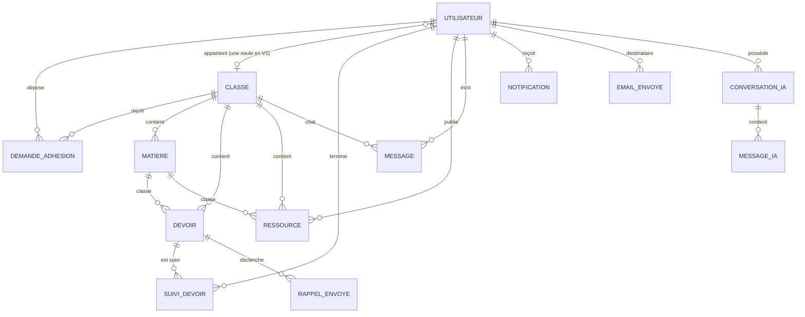

# ClassePulse V2 — Dossier de référence fonctionnel et technique

> **But du document** : donner à un développeur qui ne connaît pas ClassePulse tout ce qu'il faut savoir du **produit** pour préparer sa reconstruction de zéro. Il synthétise l'audit de la V1 (`docs/audit-classepulse/`, état du 12/10/2026, commit `4e27b02`) sans en reprendre le détail technique.
>
> **Conventions utilisées**
> - **État actuel (V1)** : *Implémentée* (présente et cohérente dans le code) · *Partielle* (présente mais avec des défauts ou un comportement incomplet) · *Incomplète* (code présent mais inutilisable) · *Absente* (annoncée, non réalisée) · *À vérifier* (dépend d'un réglage externe non observable).
> - **Statut V2** : *Conserver* (reprendre le comportement tel quel) · *Améliorer* (reprendre en corrigeant un défaut identifié) · *Redéfinir* (le besoin existe mais le comportement doit être repensé) · *Décision* (le propriétaire doit trancher).
> - Les propositions d'amélioration sont signalées par **[Proposition]** ; tout le reste décrit l'existant.
> - « Réf. audit » renvoie aux identifiants de `docs/audit-classepulse/01-inventaire-fonctionnel.md`.
> - L'application V1 n'a pas été exécutée contre une base réelle : les comportements sont établis par lecture du code.

---

## A. Présentation de ClassePulse

### Le problème
Dans une promotion d'étudiants, les échéances, les supports de cours, les anciens sujets d'examen et les informations officielles circulent de façon dispersée (messageries, bouche-à-oreille). Les dates limites sont oubliées et il n'existe pas de canal officiel pour les annonces de la classe.

### L'objectif
Centraliser la vie d'une classe dans un espace unique et réservé à ses membres : ce qu'il y a à faire et pour quand, les ressources partagées, la discussion de classe, les annonces et les rappels — chaque classe étant **isolée** des autres.

### Le public cible (confirmé par le README et le code)
- Des **étudiants**, organisés en classes (exemples de démonstration : classes d'informatique de 2ᵉ et 3ᵉ année). Le README mentionne un contexte d'école d'ingénieurs à Dakar (fuseau horaire par défaut : `Africa/Dakar`).
- L'application **n'est pas destinée aux enseignants** (README).
- Le périmètre commercial (une seule école, plusieurs établissements, offre payante…) **n'est pas documenté** → décision Q-01.

### Les utilisateurs

| Type | Description |
|---|---|
| Visiteur | Personne non connectée : découvre le produit, s'inscrit, se connecte. |
| Compte en attente | A créé un compte et demandé à rejoindre une classe ; n'accède à rien tant que la demande n'est pas acceptée. |
| Compte refusé | Sa demande a été refusée ; doit pouvoir en soumettre une nouvelle. |
| Étudiant | Membre validé d'une classe. |
| Délégué | Étudiant promu par un administrateur ; anime et modère **sa** classe. |
| Administrateur | Gère la plateforme : classes, matières, délégués, inscriptions. Créé hors de l'application. |

### Proposition de valeur
- **Pour l'étudiant** : un seul endroit pour savoir quoi rendre et quand, être rappelé avant l'échéance, retrouver documents, annales et cours, discuter avec sa classe et poser des questions à un assistant qui connaît ses données.
- **Pour le délégué** : publier les devoirs et les cours, faire des annonces officielles, valider les nouveaux membres et suivre qui a terminé quoi.
- **Pour l'administrateur** : organiser les classes et matières, désigner les délégués, contrôler les accès et suivre les envois d'emails.

### Principaux parcours (détaillés en section E)
Inscription → validation → accès à la classe ; consultation et suivi des devoirs avec rappels ; partage de ressources ; chat et annonces ; notifications ; assistant IA ; statistiques ; administration.

---

## B. Liste exhaustive des fonctionnalités

Les modules ci-dessous sont déduits de l'application réelle.

| Module | Fonctionnalités |
|---|---|
| B.1 Site public | F-001 |
| B.2 Comptes et authentification | F-002 à F-011 |
| B.3 Inscription et admission dans une classe | F-012 à F-019 |
| B.4 Classes et matières | F-020 à F-024 |
| B.5 Rôles et délégués | F-025 à F-028 |
| B.6 Devoirs et échéances | F-029 à F-035 |
| B.7 Suivi individuel des devoirs | F-036 à F-039 |
| B.8 Rappels | F-040 à F-042 |
| B.9 Ressources : documents, annales, cours enregistrés | F-043 à F-050 |
| B.10 Chat de classe et annonces | F-051 à F-056 |
| B.11 Notifications | F-057 à F-060 |
| B.12 Assistant IA | F-061 à F-068 |
| B.13 Tableaux de bord et statistiques | F-069 à F-072 |
| B.14 Suivi des emails (administration) | F-073 à F-074 |
| B.15 Préférences et ergonomie transverse | F-075 à F-076 |
| B.16 Fonctionnalités annoncées mais absentes | F-077 à F-080 |

---

### B.1 Site public

#### F-001 — Page d'accueil publique
- **Objectif** : présenter le produit et orienter vers l'inscription ou la connexion.
- **Acteurs** : visiteur.
- **Actions** : lire la présentation (bibliothèque, communauté, assistant, témoignages), aller à l'inscription ou à la connexion.
- **Règles** : contenu statique. Les trois témoignages affichés sont fictifs ; le discours annonce une aide au code par l'assistant alors que celui-ci la refuse (voir F-066).
- **Données** : aucune.
- **État V1** : Implémentée. **V2** : Redéfinir (contenu marketing à valider par le propriétaire).
- Réf. audit : F-001.

---

### B.2 Comptes et authentification

#### F-002 — Connexion
- **Objectif** : accéder à son espace.
- **Acteurs** : tout utilisateur possédant un compte.
- **Fonctionnement** : 1) saisie email + mot de passe (affichage/masquage du mot de passe possible) ; 2) contrôle anti-tentatives (F-004) ; 3) vérification anti-robot si activée (F-005) ; 4) authentification ; 5) redirection vers le tableau de bord, puis aiguillage selon l'état du compte et le rôle (F-010).
- **Règles** : email normalisé en minuscules ; en cas d'échec, message **identique** quelle que soit la cause (ne révèle pas si le compte existe) ; un utilisateur déjà connecté qui ouvre la page de connexion est renvoyé vers son tableau de bord.
- **Données** : email, mot de passe.
- **Interactions** : F-004, F-005, F-010.
- **État V1** : Implémentée. **V2** : Conserver.
- Réf. audit : F-003.

#### F-003 — Déconnexion
- **Actions** : bouton « Déconnexion » dans la barre latérale ; retour à la connexion.
- **Règles** : un compte en attente n'a **aucun** moyen de se déconnecter (la page d'attente n'a pas de bouton et la page de connexion le renvoie vers l'attente).
- **État V1** : Partielle. **V2** : Améliorer (déconnexion accessible depuis tous les écrans, y compris l'attente).
- Réf. audit : F-004.

#### F-004 — Protection contre les tentatives de connexion répétées
- **Objectif** : freiner les essais de mots de passe.
- **Règles V1** : au plus **10 tentatives par adresse IP** et **5 par compte** sur 15 minutes ; au-delà, refus avec le même message générique. Si le mécanisme de comptage est indisponible, toute connexion est refusée.
- **Limite constatée** : le blocage par compte s'applique aussi au propriétaire légitime (un tiers peut bloquer un compte).
- **État V1** : Implémentée. **V2** : Redéfinir (protéger sans permettre de bloquer un compte tiers ; seuils → Q-12).
- Réf. audit : F-003.

#### F-005 — Vérification anti-robot (CAPTCHA) à la connexion
- **Fonctionnement prévu** : un widget Cloudflare Turnstile s'affiche si une clé publique est configurée ; le serveur vérifie le jeton si une clé secrète est configurée.
- **État V1** : Incomplète (le widget n'est pas réellement chargé ; si la vérification serveur est activée, plus personne ne peut se connecter). Non configurée localement.
- **V2** : Décision (faut-il un anti-robot, et sur quels formulaires : connexion, inscription, mot de passe oublié ? → Q-12).
- Réf. audit : F-003.

#### F-006 — Mot de passe oublié : demande de lien
- **Acteurs** : visiteur.
- **Fonctionnement** : saisie de l'email → si le compte existe, un email contenant un lien de récupération est envoyé → l'écran affiche **toujours** le même message de confirmation.
- **Règles** : au plus 5 demandes par IP et 3 par compte sur 15 minutes (au-delà : même message, rien n'est envoyé).
- **État V1** : Implémentée (envoi réel dépendant du service d'emails du fournisseur d'authentification → À vérifier). **V2** : Conserver.
- Réf. audit : F-005.

#### F-007 — Validation du lien de récupération
- **Fonctionnement** : le lien reçu ouvre une session temporaire puis mène à l'écran « nouveau mot de passe ». Lien invalide, expiré ou déjà utilisé → écran « Lien invalide ou expiré » avec bouton « Recevoir un nouveau lien ».
- **État V1** : Implémentée. **V2** : Conserver. Réf. audit : F-006.

#### F-008 — Définition d'un nouveau mot de passe
- **Fonctionnement** : saisie et confirmation du nouveau mot de passe → mise à jour → **déconnexion** → retour à la connexion.
- **Règles** : 6 caractères minimum ; les deux saisies doivent être identiques. En V1, l'écran est accessible à **toute personne connectée**, pas seulement après un lien de récupération.
- **État V1** : Partielle. **V2** : Améliorer (réservé à un lien de récupération valide ; changement de mot de passe « normal » depuis le profil avec l'ancien mot de passe → **[Proposition]**, voir Q-06).
- Réf. audit : F-007.

#### F-009 — Confirmation de l'adresse email
- **État V1** : À vérifier (dépend d'un réglage du fournisseur d'authentification ; le circuit technique pour traiter un lien de confirmation existe).
- **V2** : Décision (Q-05).

#### F-010 — Aiguillage selon l'état du compte et le rôle
- **Fonctionnement** : toute page de l'espace connecté exige une session (sinon → connexion). Puis, selon la **dernière** demande d'inscription : en attente → page d'attente ; refusée → écran de nouvelle demande (F-018). Sinon l'accueil dépend du rôle : administrateur → administration ; délégué → espace délégué ; étudiant → accueil étudiant.
- **Cas limites** : un compte sans aucune demande accède à l'espace (vide) ; un utilisateur refusé tombe dans une **boucle de redirection** en V1.
- **État V1** : Partielle. **V2** : Améliorer (états de compte explicites, voir R-AD-*).
- Réf. audit : F-010.

#### F-011 — Gestion du profil personnel
- **État V1** : Absente (aucun écran pour modifier son nom, son email ou son mot de passe, ni pour supprimer son compte ou exporter ses données). Seuls le nom/prénom peuvent être ressaisis lors d'une nouvelle demande après refus.
- **V2** : Décision (Q-06).

---

### B.3 Inscription et admission dans une classe

#### F-012 — Inscription avec choix de classe
- **Objectif** : créer un compte et demander à rejoindre une classe.
- **Acteurs** : visiteur.
- **Fonctionnement** : 1) formulaire : prénom, nom, email, mot de passe, confirmation, classe (liste de toutes les classes : nom, niveau, année) ; 2) contrôle que l'email n'est pas déjà utilisé ; 3) création du compte ; 4) création du profil avec le rôle **étudiant** et **sans classe** ; 5) création d'une demande d'adhésion **en attente** pour la classe choisie ; 6) affichage de la page d'attente.
- **Règles** : prénom et nom 2 à 80 caractères ; email valide, unique sans tenir compte des majuscules ; mot de passe ≥ 6 caractères (source unique `lib/constants/password.ts`) ; classe obligatoire ; **aucune inscription ne donne le rôle administrateur** ; la classe n'est attribuée au profil qu'à l'acceptation.
- **Données** : utilisateur, profil, demande d'adhésion.
- **Interactions** : F-013, F-014, F-015.
- **État V1** : Implémentée (les étapes ne sont pas atomiques : un échec intermédiaire peut laisser un compte incomplet). **V2** : Améliorer (opération atomique).
- Réf. audit : F-002.

#### F-013 — Page d'attente
- **Fonctionnement** : message « Demande en attente… Vous recevrez un email de confirmation ».
- **Limites** : n'indique ni la classe demandée ni la date ; pas de déconnexion ; la promesse d'email n'est tenue qu'en cas d'acceptation.
- **État V1** : Partielle. **V2** : Améliorer.
- Réf. audit : F-008.

#### F-014 — Liste des demandes en attente
- **Acteurs** : délégué (demandes de **sa** classe, sur son espace) ; administrateur (demandes de **toutes** les classes, sur l'administration).
- **Affichage** : prénom, nom, **email** du demandeur, classe demandée (admin), date de la demande (délégué) ; compteur de demandes.
- **État V1** : Implémentée. **V2** : Conserver.
- Réf. audit : F-011, F-017, F-018.

#### F-015 — Accepter une demande
- **Fonctionnement** : 1) la demande doit être encore en attente (sinon « décision définitive ») ; 2) passage à « acceptée » avec l'auteur et la date de la décision ; 3) le profil est rattaché à la classe demandée ; 4) notification interne « Inscription acceptée » ; 5) email de bienvenue (F-017).
- **Règles** : une décision est **définitive** ; deux décisions simultanées ne peuvent pas aboutir toutes les deux ; un délégué ne décide que pour sa classe.
- **Interactions** : F-017, F-057.
- **État V1** : Implémentée, mais l'autorisation n'est pas contrôlée de façon fiable côté serveur. **V2** : Améliorer.
- Réf. audit : F-011.

#### F-016 — Refuser une demande
- **Fonctionnement** : passage à « refusée » ; notification interne « Inscription refusée… vous pouvez en soumettre une nouvelle » ; **aucun email**.
- **Limite** : la notification n'est jamais visible (l'utilisateur refusé n'accède pas à son espace) ; aucun motif de refus.
- **État V1** : Implémentée. **V2** : Décision (email et motif de refus → Q-08).
- Réf. audit : F-011.

#### F-017 — Email de bienvenue à l'acceptation
- **Contenu** : « Votre accès a été accepté », bouton « Se connecter », adresse de contact de l'administration ; introduction éventuellement personnalisée par IA (F-042).
- **Règles** : envoyé **une seule fois** par utilisateur (anti-doublon) ; chaque envoi est journalisé (envoyé / échec avec motif) ; l'échec d'envoi ne bloque pas l'acceptation ; si aucun service d'email n'est configuré, l'envoi est ignoré sans erreur.
- **État V1** : Implémentée. **V2** : Conserver.
- Réf. audit : F-012.

#### F-018 — Nouvelle demande après refus
- **Fonctionnement prévu** : l'utilisateur refusé, connecté, ressaisit prénom/nom et choisit une classe ; une **nouvelle** demande en attente est créée (l'ancienne reste dans l'historique).
- **Règles** : impossible si une demande est déjà en attente, si le compte est déjà accepté, ou pour un administrateur.
- **État V1** : Incomplète (logique présente mais écran inaccessible à cause d'une boucle de redirection). **V2** : Améliorer.
- Réf. audit : F-009.

#### F-019 — Historique des demandes d'adhésion
- **Fonctionnement** : chaque demande est conservée (classe, statut, auteur et date de décision) ; une seule demande en attente à la fois par utilisateur.
- **Consultation** : aucun écran d'historique.
- **État V1** : Partielle (données présentes, pas d'interface). **V2** : Décision (afficher l'historique aux admins ? → Q-08).

---

### B.4 Classes et matières

#### F-020 — Créer une classe
- **Acteurs** : administrateur.
- **Données** : nom (2-50), niveau (2-100), année académique au format `AAAA-AAAA`.
- **Règles** : le couple (nom, année) est unique.
- **État V1** : Implémentée (aucun message d'erreur ou de succès affiché). **V2** : Conserver + retours utilisateur.
- Réf. audit : F-013.

#### F-021 — Consulter la liste des classes
- **Acteurs** : administrateur (liste « Classes existantes ») ; **visiteur** (liste déroulante de l'inscription).
- **Règle** : la liste des classes (nom, niveau, année) est publique en V1. → Q-02 (acceptable ?).
- **État V1** : Implémentée. **V2** : Conserver / Décision sur la visibilité.

#### F-022 — Supprimer une classe
- **Acteurs** : administrateur (avec confirmation).
- **Règles** : refusée si au moins un utilisateur est rattaché à la classe ; la suppression emporte matières, devoirs, ressources, messages et demandes de la classe.
- **Limites** : en cas de refus, l'écran se ferme comme si la suppression avait réussi ; aucun moyen de retirer les membres d'une classe, donc une classe utilisée n'est jamais supprimable.
- **État V1** : Partielle. **V2** : Redéfinir (archivage de classe ? fin d'année scolaire ? → Q-03).
- Réf. audit : F-014.

#### F-023 — Créer une matière
- **Acteurs** : administrateur **uniquement**.
- **Données** : classe, nom (2-100), code facultatif (≤ 20).
- **Règles** : nom unique dans une classe ; une matière appartient à une seule classe. Sans matière, aucun devoir ni ressource ne peut être créé dans la classe.
- **Absent** : modification et suppression d'une matière.
- **État V1** : Implémentée. **V2** : Améliorer + Décision (le délégué peut-il gérer les matières ? → Q-04).
- Réf. audit : F-015.

#### F-024 — Appartenance à une classe
- **Règles V1** : un utilisateur appartient à **au plus une classe** ; il y est rattaché à l'acceptation de sa demande ; un administrateur peut n'appartenir à aucune classe.
- **Absent** : retrait d'un membre, changement de classe, appartenance à plusieurs classes, passage d'une année à l'autre.
- **État V1** : Partielle. **V2** : Décision (Q-03).

---

### B.5 Rôles et délégués

#### F-025 — Liste des membres par classe (administration)
- **Affichage** : membres (étudiants et délégués) regroupés par classe, avec nom, email, badge « Délégué » ; un groupe « Sans classe » regroupe les comptes non rattachés (par exemple en attente).
- **État V1** : Implémentée. **V2** : Conserver.

#### F-026 — Promouvoir un étudiant délégué
- **Acteurs** : administrateur.
- **Effet** : rôle → délégué ; notification « Nomination délégué ».
- **Limites** : possible sur un compte sans classe (délégué de rien) ; plusieurs délégués par classe sont possibles (aucune limite). → Q-04.
- **État V1** : Implémentée. **V2** : Améliorer.
- Réf. audit : F-016.

#### F-027 — Révoquer un délégué
- **Effet** : rôle → étudiant ; notification « Rôle délégué retiré ».
- **État V1** : Implémentée. **V2** : Conserver.

#### F-028 — Création d'un administrateur
- **Fonctionnement** : uniquement **hors de l'application**, par une commande d'exploitation qui crée un compte confirmé avec le rôle administrateur, sans classe.
- **Absent** : promotion/révocation d'administrateur depuis l'interface.
- **État V1** : Implémentée (outil en ligne de commande). **V2** : Décision (Q-04).
- Réf. audit : F-050.

---

### B.6 Devoirs et échéances

Un « devoir » (appelé *tâche* dans le code) est publié pour toute la classe ; chaque étudiant indique ensuite individuellement s'il l'a terminé (B.7).

#### F-029 — Publier un devoir
- **Acteurs** : délégué (sa classe) ; administrateur.
- **Données** : titre (3-150), matière de la classe, type (Exercice, TP, Devoir, Recherche, Projet, Autre), date et heure limite, consignes (≤ 3000, facultatif), lien de ressource Google Drive (facultatif).
- **Fonctionnement** : création → notification « Nouveau devoir » à tous les membres de la classe sauf l'auteur.
- **Règles** : la matière doit appartenir à la classe ; seuls les liens Google Drive sont acceptés (le champ suggère pourtant OneDrive/GitHub).
- **Limite** : un administrateur sans classe ne peut pas publier (aucun choix de classe).
- **Interactions** : F-057, F-040/F-041, assistant (F-061).
- **État V1** : Implémentée (erreurs non affichées). **V2** : Améliorer.
- Réf. audit : F-020.

#### F-030 — Modifier un devoir
- **Acteurs** : délégué de la classe ; administrateur.
- **Champs modifiables** : titre, matière, type, échéance, lien, consignes (pas la classe).
- **Effet** : notification « Devoir modifié » à toute la classe (y compris l'auteur).
- **État V1** : Implémentée (contrôle d'autorisation fragile). **V2** : Améliorer.

#### F-031 — Supprimer un devoir
- **Acteurs** : délégué de la classe ; administrateur. **Sans confirmation** en V1.
- **Effet** : supprime aussi les suivis, rappels et journaux d'emails liés.
- **État V1** : Implémentée. **V2** : Améliorer (confirmation, voir Q-07 sur la conservation).

#### F-032 — Consulter les devoirs de la classe
- **Acteurs** : tous les membres validés.
- **Affichage** : tous les devoirs de la classe triés par échéance, chacun avec type, indicateur d'échéance (F-033), consignes, date limite, lien de pièce jointe, case « terminé ». Mise à jour automatique quand un devoir est ajouté, modifié ou supprimé.
- **État V1** : Implémentée. **V2** : Conserver (filtres/tri → Q-10).

#### F-033 — Indicateurs d'échéance et d'urgence
- **Comportement affiché en V1** : « Terminé » ; « Expiré » si la date est passée ; « X h restantes » sous 24 h ; « X j restant(s) » sous 48 h ; sinon « J-n ».
- **Règle documentée mais non utilisée** : vert à J-5 et au-delà, jaune de J-4 à J-2, rouge à J-1 et le jour J, en jours calendaires dans le fuseau de l'application.
- **Constat** : trois calculs différents coexistent (affichage, accueil, assistant) et peuvent se contredire.
- **État V1** : Partielle. **V2** : Redéfinir (une règle unique → Q-07).
- Réf. audit : F-025.

#### F-034 — Expiration automatique
- **Fonctionnement** : chaque jour (06:30 UTC), les devoirs dont l'échéance est passée sont marqués « expirés » ; ils n'apparaissent plus dans l'accueil étudiant ni dans les rappels, mais restent dans la liste des devoirs.
- **État V1** : Implémentée. **V2** : Conserver.

#### F-035 — Suppression automatique des devoirs échus
- **Fonctionnement** : chaque jour, les devoirs dont l'échéance est dépassée de **plus de 24 h** sont **supprimés définitivement** (avec les suivis et l'historique des emails). En pratique, un devoir reste visible entre 24 h et 48 h après l'échéance.
- **Conséquence** : aucun historique des devoirs ni des statistiques de complétion.
- **État V1** : Implémentée. **V2** : Décision (suppression, archivage ou conservation → Q-07).
- Réf. audit : F-026.

---

### B.7 Suivi individuel des devoirs

#### F-036 — Marquer un devoir comme terminé / non terminé
- **Acteurs** : tout membre validé (y compris délégués et administrateurs rattachés).
- **Fonctionnement** : case à cocher sur chaque devoir ; l'état est propre à chaque étudiant ; décocher annule.
- **Règles** : un seul état par étudiant et par devoir ; un devoir expiré reste cochable ; un étudiant ayant terminé ne reçoit plus de rappel.
- **État V1** : Implémentée (échec silencieux). **V2** : Conserver (cochage après échéance → Q-07).
- Réf. audit : F-023.

#### F-037 — Progression personnelle (accueil étudiant)
- **Affichage** : pourcentage terminé, « X à faire », « Y de Z terminées », calculé sur les **6 prochains** devoirs non expirés.
- **État V1** : Implémentée. **V2** : Conserver (périmètre du calcul → Q-10).

#### F-038 — Suivi de complétion par élève
- **Acteurs** : délégué, administrateur.
- **Affichage** : pour chaque devoir, « Suivi (n / total terminés) » et la liste des étudiants et délégués de la classe avec « Terminé » ou « En attente ».
- **État V1** : Implémentée. **V2** : Conserver.

#### F-039 — Notification « tâche terminée »
- **Fonctionnement** : chaque fois qu'un étudiant coche un devoir, **tous les autres membres** reçoivent « X a terminé : titre ».
- **Limite** : volume de notifications élevé ; cocher/décocher répète la notification ; dévoile la progression de chacun à toute la classe.
- **État V1** : Implémentée. **V2** : Décision (Q-09).

---

### B.8 Rappels

#### F-040 — Rappels internes J-3 et J-1
- **Fonctionnement** : chaque jour à 06:00 UTC, pour chaque devoir non expiré dont l'échéance tombe dans **exactement 3 jours** ou **1 jour** (jours calendaires dans le fuseau de l'application), chaque membre de la classe qui ne l'a pas terminé reçoit la notification « Échéance dans 3 jours » ou « Échéance demain ».
- **Règles** : au plus un rappel de chaque type par devoir et par étudiant ; pas de rappel le jour J ; un devoir créé à J-1 après l'heure du traitement ne reçoit pas de rappel J-1 ; si l'échéance est modifiée, le calcul est refait le lendemain.
- **État V1** : Implémentée (exécution réelle à vérifier). **V2** : Conserver (heure d'envoi, fréquence → Q-09).
- Réf. audit : F-027.

#### F-041 — Rappels par email J-3 et J-1
- **Fonctionnement** : en même temps que F-040, un email « Rappel : devoir à rendre dans 3 jours » ou « Dernier rappel : devoir à rendre demain » (titre, matière, date et heure limite, bouton « Voir le devoir »).
- **Règles** : jamais deux fois le même email pour le même devoir et le même étudiant ; pas d'envoi si le devoir est terminé ou expiré ; chaque envoi est journalisé ; un envoi en échec n'est pas retenté.
- **Absent** : désinscription ou préférences d'emails.
- **État V1** : Implémentée. **V2** : Améliorer (reprise des échecs **[Proposition]** ; préférences → Q-09).

#### F-042 — Personnalisation des emails par IA (optionnelle)
- **Fonctionnement** : si un service d'IA est configuré, une phrase d'introduction courte et personnalisée (ton selon le type d'email, sans aucune information factuelle) remplace l'introduction standard ; délai maximal 3 s ; en cas d'échec, l'introduction standard est utilisée.
- **Règle** : les informations académiques (devoir, date, lien) viennent toujours des données, jamais de l'IA.
- **État V1** : Implémentée. **V2** : Décision (utile ? → Q-11).

---

### B.9 Ressources : documents, annales, cours enregistrés

ClassePulse **ne stocke aucun fichier** : toutes les ressources sont des liens vers Google Drive, partagés par leur auteur en « lecture pour toute personne disposant du lien ».

#### F-043 — Déposer un document
- **Acteurs** : tout membre validé.
- **Données** : titre (2-150), matière, lien Google Drive, description (≤ 1000, facultative).
- **Effet** : notification « Nouveau document » à la classe (sauf l'auteur).
- **État V1** : Implémentée (vérification du lien insuffisante). **V2** : Améliorer.

#### F-044 — Supprimer un document
- **Acteurs** : son auteur, le délégué de la classe, un administrateur ; avec confirmation.
- **État V1** : Implémentée. **V2** : Conserver.

#### F-045 — Ajouter une annale (« Hint »)
- **Objectif** : partager d'anciens devoirs, contrôles, examens ou corrigés.
- **Acteurs** : tout membre validé.
- **Données** : titre, matière, année (`AAAA` ou `AAAA-AAAA`), type (Devoir, Examen, Contrôle, TP, Projet, Autre), lien Google Drive.
- **Effet** : notification « Nouveau hint » à la classe.
- **État V1** : Implémentée. **V2** : Conserver (libellés des types à franciser à l'affichage).

#### F-046 — Supprimer une annale
- Mêmes règles que F-044. **État V1** : Implémentée. **V2** : Conserver.

#### F-047 — Publier un cours enregistré
- **Acteurs** : délégué de la classe, administrateur **uniquement**.
- **Données** : titre, matière, date du cours, lien Google Drive (vidéo), description facultative.
- **Effet** : notification « Nouveau cours enregistré » à la classe.
- **État V1** : Implémentée. **V2** : Conserver.

#### F-048 — Supprimer un cours enregistré
- **Acteurs** : délégué de la classe, administrateur ; avec confirmation.
- **État V1** : Implémentée. **V2** : Conserver.

#### F-049 — Consulter les ressources
- **Affichage** : documents (du plus récent au plus ancien), annales (par année décroissante), cours (par date décroissante) ; bouton d'ouverture du lien dans un nouvel onglet ; les 5 derniers documents sur l'accueil étudiant.
- **Absent** : recherche, filtre par matière, tri, modification d'une ressource (il faut supprimer et recréer).
- **État V1** : Implémentée. **V2** : Conserver + Décision (Q-10).

#### F-050 — Mise à jour en direct des listes
- **Fonctionnement** : les listes de devoirs, documents, annales et cours se rafraîchissent automatiquement quand un autre membre ajoute ou supprime un élément.
- **État V1** : Implémentée (propagation des suppressions à vérifier). **V2** : Conserver.

---

### B.10 Chat de classe et annonces

#### F-051 — Envoyer un message
- **Acteurs** : tout membre validé, dans le chat de **sa** classe.
- **Règles** : 1 à 2 000 caractères ; le message s'affiche immédiatement chez l'auteur puis est confirmé ; en cas d'échec il disparaît sans message d'erreur.
- **Absent** : modification d'un message, pièces jointes, réponses, réactions, mentions.
- **État V1** : Implémentée. **V2** : Conserver.

#### F-052 — Recevoir les messages en temps réel
- **Fonctionnement** : les nouveaux messages apparaissent sans recharger la page, avec le nom de l'auteur et l'heure ; défilement automatique vers le bas.
- **Absent** : indicateur « en ligne », indicateur de frappe, notification de nouveau message.
- **État V1** : Implémentée. **V2** : Conserver.

#### F-053 — Historique paginé
- **Fonctionnement** : ouverture sur les **50 derniers messages** ; bouton « Charger les messages précédents » (par 30).
- **État V1** : Implémentée. **V2** : Conserver.

#### F-054 — Supprimer un message (modération)
- **Acteurs** : l'auteur ; le délégué de la classe et l'administrateur pour tout message de la classe.
- **Règles** : suppression **sans confirmation** ; le bouton n'apparaît qu'au survol (inaccessible sur mobile).
- **État V1** : Implémentée. **V2** : Améliorer.

#### F-055 — Publier une annonce officielle
- **Acteurs** : délégué de la classe, administrateur.
- **Fonctionnement** : bouton « mégaphone » dans le chat → saisie (≤ 2 000 caractères) → l'annonce apparaît dans le fil, encadrée et marquée « Annonce Officielle » avec le nom de l'auteur.
- **Règles** : un étudiant ne peut jamais publier d'annonce ; une annonce ne peut pas être modifiée ; elle se supprime comme un message.
- **Limite** : les annonces ne sont **pas épinglées** ; elles défilent avec les messages.
- **État V1** : Implémentée. **V2** : Redéfinir (espace d'annonces distinct ou épinglage ? → Q-09).

#### F-056 — Notification d'annonce
- **Effet** : chaque membre (sauf l'auteur) reçoit « Annonce — X a publié une annonce : » suivi des 120 premiers caractères.
- **Absent** : email pour les annonces.
- **État V1** : Implémentée. **V2** : Conserver (email → Q-09).

---

### B.11 Notifications

#### F-057 — Création automatique des notifications
Les notifications ne sont créées que par le système. Catalogue des événements réellement émis :

| Événement | Destinataires | Catégorie | Lien |
|---|---|---|---|
| Nouveau devoir | classe sauf auteur | Devoirs | Devoirs |
| Devoir modifié | toute la classe | Devoirs | Devoirs |
| Devoir terminé par un étudiant | classe sauf l'étudiant | Devoirs | Devoirs |
| Rappel J-3 / J-1 | étudiants n'ayant pas terminé | Devoirs | Devoirs |
| Nouveau document | classe sauf auteur | Documents | Documents |
| Nouvelle annale | classe sauf auteur | Hints | Annales |
| Nouveau cours enregistré | classe sauf auteur | Cours | Cours |
| Annonce | classe sauf auteur | Annonces | Chat |
| Inscription acceptée / refusée | demandeur | Système | — |
| Nommé / retiré délégué | intéressé | Système | Accueil |

- **Règles** : une notification n'est jamais modifiable par son destinataire, sauf son état lu/non lu ; types prévus mais jamais émis : « devoir créé » (ancien), « cours enregistré », « cours modifié ».
- **État V1** : Implémentée. **V2** : Conserver (catalogue à revoir → Q-09).

#### F-058 — Centre de notifications
- **Fonctionnement** : affiche les 100 dernières notifications, regroupées par « Aujourd'hui », « Hier » puis par date ; 8 filtres : Toutes, Non lues, Devoirs, Cours, Documents, Hints, Annonces, Système ; affichage par lots de 30 (« Charger plus ») ; nouvelles notifications ajoutées en direct ; clic sur une notification = marquée lue + ouverture de la page liée.
- **État V1** : Implémentée. **V2** : Conserver.

#### F-059 — Marquer comme lu / tout marquer comme lu
- **État V1** : Implémentée (pas de « marquer comme non lu » dans l'interface, pas de suppression de notification). **V2** : Conserver.

#### F-060 — Compteur de notifications (cloche)
- **Fonctionnement** : badge du nombre de non lues dans l'en-tête (« 9+ » au-delà de 9), mis à jour en direct.
- **Limite** : le compteur peut devenir inexact.
- **État V1** : Partielle. **V2** : Améliorer.

---

### B.12 Assistant IA

#### F-061 — Poser une question à l'assistant
- **Acteurs** : tout utilisateur connecté (en V1, **même non validé**).
- **Fonctionnement** : 1) bouton flottant « Assistant IA » sur tout l'espace connecté ; 2) question (≤ 2 000 caractères) ; 3) contrôle des quotas (F-067) et du sujet (F-066) ; 4) l'assistant reçoit le prénom, le rôle, la classe, la date et l'heure, et les 30 derniers messages de la conversation ; 5) il consulte, **avec les droits de l'utilisateur**, les données nécessaires : devoirs à venir (fenêtre 1 à 90 jours, 7 par défaut), tous les devoirs, cours enregistrés, documents, annales, notifications (non lues ou toutes), recherche par titre dans les ressources et devoirs ; 6) réponse en français, en markdown simple, affichée progressivement.
- **Règles** : ne doit citer que des données réellement consultées ; ne voit que ce que l'utilisateur a le droit de voir ; aucune action d'écriture.
- **Données** : conversations et messages de l'assistant.
- **État V1** : Implémentée. **V2** : Conserver + Décision (accès réservé aux comptes validés ? → Q-11).
- Réf. audit : F-042.

#### F-062 — Actions rapides
- Cinq raccourcis : « Mes devoirs », « Mes tâches », « Mes cours », « Mes deadlines », « Mes notifications ».
- **État V1** : Implémentée. **V2** : Conserver.

#### F-063 — Boutons de navigation proposés
- **Fonctionnement** : l'assistant peut proposer jusqu'à 3 boutons menant à une page de l'application, choisis **uniquement** parmi : accueil, devoirs, documents, annales, cours, chat, notifications, statistiques, administration.
- **État V1** : Implémentée. **V2** : Conserver.

#### F-064 — Historique des conversations
- **Fonctionnement** : liste des 50 conversations les plus récentes ; ouvrir (100 messages max affichés), nouvelle conversation, supprimer ; la conversation prend pour titre le début de la première question.
- **État V1** : Implémentée. **V2** : Conserver.

#### F-065 — Renommer une conversation
- **État V1** : Incomplète (prévu côté serveur, aucun bouton). **V2** : Décision.

#### F-066 — Limitation au périmètre de la plateforme
- **Fonctionnement** : refus immédiat (sans appel à l'IA) des questions contenant des sujets hors périmètre : tentatives de détournement des consignes, finance/crypto, politique, religion, santé, juridique, vie sentimentale, contenus sexuels, armes/drogues, jeux d'argent, calculs. Message de refus + bouton « Mes devoirs ». Les consignes de l'IA interdisent aussi la culture générale et le code hors plateforme.
- **Contradiction** : la barre latérale et la page d'accueil présentent l'assistant comme une aide sur « un cours ou du code ».
- **État V1** : Implémentée. **V2** : Décision (périmètre pédagogique → Q-11).

#### F-067 — Quotas d'utilisation
- **Règles V1** : par utilisateur, au plus 10 questions par minute, 60 par heure et 100 par jour (valeur quotidienne paramétrable) ; message indiquant quand réessayer.
- **État V1** : Implémentée. **V2** : Conserver (valeurs → Q-11).

#### F-068 — Fonctionnement sans IA
- **Fonctionnement** : si aucun service d'IA n'est configuré ou s'il est en erreur, l'assistant répond par un message explicatif et un bouton de navigation, sans planter.
- **État V1** : Implémentée. **V2** : Conserver.

---

### B.13 Tableaux de bord et statistiques

#### F-069 — Accueil étudiant
- **Contenu** : date du jour et salutation selon l'heure ; prénom ; nombre de devoirs urgents (sous 48 h), de devoirs de la semaine, de nouvelles ressources ; anneau de progression (F-037) ; alerte rouge listant les devoirs des 48 prochaines heures ; « À faire prochainement » (6 devoirs avec case à cocher) ; 5 derniers documents ; raccourcis vers annales et cours ; citation aléatoire.
- **Règle** : un délégué ou un administrateur est envoyé sur son propre accueil et ne voit pas cette vue.
- **État V1** : Implémentée. **V2** : Conserver (accueil étudiant pour les délégués → Q-10).

#### F-070 — Espace délégué
- **Contenu** : nombre de membres de la classe, nombre de devoirs (expirés compris), nombre de demandes en attente ; liste des demandes avec Accepter / Refuser.
- **État V1** : Implémentée. **V2** : Conserver.

#### F-071 — Accueil administration
- **Contenu** : nombre de classes, d'étudiants, de délégués, de devoirs ; demandes en attente de toutes les classes ; gestion des délégués par classe ; création/suppression de classes ; création de matières ; accès au suivi des emails.
- **Limite** : un administrateur sans classe ne voit ni ne gère aucun devoir, ressource ou chat.
- **État V1** : Implémentée. **V2** : Améliorer (choix de la classe gérée → Q-04).

#### F-072 — Statistiques
- **Acteurs** : délégué (sa classe), administrateur (toutes les classes + tableau par classe). Interdit aux étudiants.
- **Indicateurs** : étudiants, délégués, devoirs créés, documents, annales, cours, complétions, taux de complétion = complétions ÷ (devoirs × étudiants) ; pour l'administrateur, par classe : étudiants, devoirs, complétions, taux.
- **Limites** : calculés en direct sur les données restantes (les devoirs supprimés disparaissent) ; le taux compte les complétions des délégués mais pas les délégués dans le dénominateur.
- **État V1** : Implémentée. **V2** : Redéfinir (indicateurs attendus → Q-10).

---

### B.14 Suivi des emails (administration)

#### F-073 — Tableau de bord des emails
- **Acteurs** : administrateur.
- **Contenu** : expéditeur, nom d'expéditeur, service actif (SMTP, service de secours, non configuré) ; compteurs total / envoyés / échecs / en attente ; 20 derniers emails (destinataire, nom de l'utilisateur, devoir concerné, type : accès accepté, rappel J-3, rappel J-1 ; statut, motif d'échec, date).
- **État V1** : Implémentée. **V2** : Conserver.

#### F-074 — Email de test
- **Acteurs** : administrateur.
- **Fonctionnement** : vérifie la connexion au service d'email puis envoie un email de test ; affiche les étapes et le résultat.
- **Règle** : le destinataire est l'adresse d'expédition de la plateforme ou une adresse figurant sur une liste autorisée par configuration.
- **État V1** : Implémentée. **V2** : Conserver.

---

### B.15 Préférences et ergonomie transverse

#### F-075 — Thème clair / sombre
- **Fonctionnement** : bouton dans l'en-tête et sur les pages publiques ; choix mémorisé sur l'appareil.
- **Absent** : autres préférences (langue, notifications, emails).
- **État V1** : Implémentée. **V2** : Conserver (préférences → Q-09).

#### F-076 — Confirmation avant suppression
- **Fonctionnement** : fenêtre « Supprimer … ? Cette action est irréversible » avec le nom de l'élément, Annuler / Supprimer, affichage de l'erreur éventuelle ; utilisable au clavier.
- **Couverture** : documents, annales, cours, classes — **pas** les devoirs ni les messages.
- **État V1** : Partielle. **V2** : Améliorer (généraliser).

Autres comportements transverses V1 : écrans de chargement squelettes sur toutes les pages de l'espace connecté ; états vides illustrés ; menu latéral transformé en tiroir sur mobile ; aucune page d'erreur personnalisée ; **aucun retour (succès/erreur)** après la plupart des formulaires → **[Proposition]** retour systématique en V2.

---

### B.16 Fonctionnalités annoncées mais absentes

| ID | Fonctionnalité | Constat | V2 |
|---|---|---|---|
| F-077 | Recherche globale | Bouton « Rechercher » présent dans l'en-tête, sans effet ; seule l'IA sait chercher | Décision (Q-10) |
| F-078 | Présence en ligne des membres | Annoncée dans le README ; donnée prévue mais jamais alimentée | Décision |
| F-079 | Indicateur de connexion temps réel (« Connexion perdue — reconnexion… ») | Annoncé ; code prévu mais non utilisé | Décision |
| F-080 | Appartenance historisée aux classes | Structure prévue en base, jamais utilisée | Décision (Q-03) |

Une messagerie privée entre utilisateurs a existé puis a été **volontairement supprimée** ; elle ne fait pas partie du produit actuel.

---

## C. Règles métier à préserver

Statut : **Confirmée** (observée dans la V1) · **Inconnue** (à trancher, renvoi aux questions de la section I).

### Rôles et accès
| ID | Règle | Statut |
|---|---|---|
| R-RO-01 | Trois rôles : étudiant, délégué, administrateur. | Confirmée |
| R-RO-02 | L'inscription publique donne toujours le rôle étudiant ; un administrateur n'est jamais créé par l'inscription. | Confirmée |
| R-RO-03 | Seul un administrateur peut promouvoir ou révoquer un délégué. | Confirmée |
| R-RO-04 | Un utilisateur ne peut jamais modifier lui-même son rôle ni sa classe. | Confirmée |
| R-RO-05 | Un délégué n'a de pouvoirs que sur **sa** classe. | Confirmée |
| R-RO-06 | Nombre de délégués par classe, délégué sans classe, création d'administrateurs depuis l'interface. | Inconnue (Q-04) |

### Classes et appartenance
| ID | Règle | Statut |
|---|---|---|
| R-CL-01 | Chaque classe est isolée : un membre ne voit que les données de sa classe ; l'administrateur voit tout. | Confirmée |
| R-CL-02 | Un utilisateur appartient à une seule classe. | Confirmée (V2 : Inconnue, Q-03) |
| R-CL-03 | Une classe est identifiée par (nom, année académique), unique. | Confirmée |
| R-CL-04 | Une matière appartient à une classe ; son nom est unique dans la classe ; toute ressource ou devoir doit utiliser une matière de **sa** classe. | Confirmée |
| R-CL-05 | Une classe n'est supprimable que si aucun membre n'y est rattaché ; sa suppression efface tout son contenu. | Confirmée (V2 : Inconnue, Q-03) |

### Cycle de vie des inscriptions
| ID | Règle | Statut |
|---|---|---|
| R-AD-01 | États d'une demande : en attente → acceptée **ou** refusée. | Confirmée |
| R-AD-02 | Une seule demande en attente par utilisateur ; les demandes passées sont conservées. | Confirmée |
| R-AD-03 | Seuls le délégué de la classe demandée et les administrateurs décident. | Confirmée |
| R-AD-04 | Une décision est définitive. | Confirmée (V2 : Inconnue, Q-08) |
| R-AD-05 | L'accès aux données d'une classe exige une demande acceptée (sauf administrateur). | Confirmée |
| R-AD-06 | La classe n'est attribuée qu'à l'acceptation. | Confirmée |
| R-AD-07 | Après un refus, l'utilisateur peut déposer une nouvelle demande (éventuellement pour une autre classe). | Confirmée (non accessible en V1) |
| R-AD-08 | Acceptation : notification + email unique ; refus : notification seulement. | Confirmée (V2 : Inconnue, Q-08) |

### Devoirs
| ID | Règle | Statut |
|---|---|---|
| R-DE-01 | Seuls délégués et administrateurs publient, modifient et suppriment les devoirs. | Confirmée |
| R-DE-02 | Un devoir a une matière, un type parmi 6, une date et heure limite. | Confirmée |
| R-DE-03 | Le suivi « terminé » est individuel. | Confirmée |
| R-DE-04 | Un devoir est expiré dès que son échéance est passée. | Confirmée |
| R-DE-05 | Un devoir est supprimé définitivement 24 h après son échéance. | Confirmée (V2 : Inconnue, Q-07) |
| R-DE-06 | Les jours restants se comptent en jours calendaires dans le fuseau de l'application. | Confirmée pour les rappels ; l'affichage V1 ne la respecte pas (Q-07) |
| R-DE-07 | Comportement après échéance (cochage, modification). | Inconnue (Q-07) |

### Rappels
| ID | Règle | Statut |
|---|---|---|
| R-RA-01 | Rappels à J-3 et J-1, par notification et par email. | Confirmée |
| R-RA-02 | Pas de rappel si le devoir est terminé ou expiré. | Confirmée |
| R-RA-03 | Jamais deux rappels du même type pour le même devoir et le même étudiant. | Confirmée |
| R-RA-04 | Traitement quotidien (06:00 UTC). | Confirmée (heure à confirmer, Q-09) |

### Ressources
| ID | Règle | Statut |
|---|---|---|
| R-RE-01 | Les ressources sont des liens Google Drive ; aucun fichier n'est hébergé. | Confirmée (V2 : Inconnue, Q-02) |
| R-RE-02 | Tout membre peut ajouter documents et annales ; seuls délégués et administrateurs publient des cours enregistrés. | Confirmée |
| R-RE-03 | Suppression : auteur, délégué de la classe ou administrateur (documents, annales) ; délégué ou administrateur (cours). | Confirmée |
| R-RE-04 | Une ressource n'est pas modifiable. | Confirmée (V2 : Inconnue) |

### Chat, annonces et notifications
| ID | Règle | Statut |
|---|---|---|
| R-CH-01 | Un chat par classe, réservé à ses membres validés ; messages de 1 à 2 000 caractères. | Confirmée |
| R-CH-02 | Un message ne peut pas être modifié ; il peut être supprimé par son auteur, le délégué ou un administrateur. | Confirmée |
| R-CH-03 | Seuls délégués et administrateurs publient des annonces ; chaque annonce notifie toute la classe. | Confirmée |
| R-NO-01 | Les notifications sont créées par le système uniquement ; le destinataire ne peut changer que l'état lu/non lu. | Confirmée |
| R-NO-02 | L'auteur d'un événement n'est pas notifié de sa propre action (sauf « devoir modifié »). | Confirmée |

### Assistant
| ID | Règle | Statut |
|---|---|---|
| R-IA-01 | L'assistant ne lit que les données accessibles à l'utilisateur et n'écrit jamais. | Confirmée |
| R-IA-02 | Il ne propose que des liens internes d'une liste fermée. | Confirmée |
| R-IA-03 | Il se limite à la plateforme et à la vie de classe. | Confirmée (V2 : Inconnue, Q-11) |
| R-IA-04 | Quotas par utilisateur (10/min, 60/h, 100/jour). | Confirmée (valeurs : Q-11) |

### Comptes et conservation des données
| ID | Règle | Statut |
|---|---|---|
| R-CO-01 | Email unique (insensible à la casse), mot de passe ≥ 6 caractères. | Confirmée |
| R-CO-02 | Les messages d'erreur de connexion distinguent le quota dépassé (avec délai d'attente), l'indisponibilité du garde-fou et des identifiants refusés — sans jamais révéler si l'adresse email existe. | Confirmée |
| R-CO-03 | Durées de conservation des comptes, messages, conversations IA, notifications, journaux. | **Inconnue** (aucune règle en V1 hormis la suppression des devoirs) — Q-06 |
| R-CO-04 | Suppression de compte et export des données. | **Inconnue** (absent en V1) — Q-06 |

---

## D. Matrice des permissions (comportement V1)

Légende : ✅ autorisé · ❌ interdit · **SC** = uniquement dans sa classe · **Auteur** = uniquement ses propres éléments · ⚠️ = point à décider ou incohérent en V1.
« Administrateur » désigne un administrateur sans classe ; en V1 il ne peut, en pratique, pas utiliser les écrans de contenu d'une classe (⚠️ Q-04).

| Module | Action | Étudiant | Délégué | Administrateur |
|---|---|---|---|---|
| Comptes | Se connecter, se déconnecter, récupérer son mot de passe | ✅ | ✅ | ✅ |
| Comptes | Modifier son profil, supprimer son compte | ❌ (absent) ⚠️ | ❌ ⚠️ | ❌ ⚠️ |
| Admission | S'inscrire / redemander après refus | ✅ | — | — |
| Admission | Voir les demandes en attente | ❌ | ✅ SC | ✅ toutes |
| Admission | Accepter / refuser | ❌ | ✅ SC | ✅ toutes |
| Classes | Voir la liste des classes | ✅ (aussi les visiteurs) | ✅ | ✅ |
| Classes | Créer / supprimer une classe | ❌ | ❌ | ✅ |
| Classes | Modifier une classe | ❌ | ❌ | ❌ (absent) ⚠️ |
| Matières | Voir | ✅ SC | ✅ SC | ✅ |
| Matières | Créer | ❌ | ❌ ⚠️ | ✅ |
| Matières | Modifier / supprimer | ❌ | ❌ | ❌ (absent) ⚠️ |
| Membres | Voir les membres (nom) | ✅ SC (noms visibles via chat/suivi) | ✅ SC | ✅ tous, avec email |
| Membres | Retirer / changer de classe | ❌ | ❌ | ❌ (absent) ⚠️ |
| Rôles | Promouvoir / révoquer un délégué | ❌ | ❌ | ✅ |
| Rôles | Créer un administrateur | ❌ | ❌ | Hors application ⚠️ |
| Devoirs | Consulter | ✅ SC | ✅ SC | ✅ ⚠️ |
| Devoirs | Créer / modifier / supprimer | ❌ | ✅ SC | ✅ ⚠️ |
| Suivi | Cocher ses devoirs | ✅ Auteur | ✅ Auteur | ✅ (si rattaché) |
| Suivi | Voir la progression de chaque élève | ❌ (voit seulement les notifications « X a terminé ») ⚠️ | ✅ SC | ✅ |
| Documents / annales | Consulter | ✅ SC | ✅ SC | ✅ |
| Documents / annales | Ajouter | ✅ SC | ✅ SC | ✅ ⚠️ |
| Documents / annales | Supprimer | ✅ Auteur | ✅ SC | ✅ |
| Cours enregistrés | Consulter | ✅ SC | ✅ SC | ✅ |
| Cours enregistrés | Publier / supprimer | ❌ | ✅ SC | ✅ ⚠️ |
| Ressources | Modifier | ❌ (absent) | ❌ | ❌ ⚠️ |
| Chat | Lire / écrire | ✅ SC | ✅ SC | ✅ ⚠️ |
| Chat | Supprimer un message | ✅ Auteur | ✅ SC | ✅ |
| Annonces | Publier | ❌ | ✅ SC | ✅ ⚠️ |
| Notifications | Consulter, marquer lu | ✅ les siennes | ✅ les siennes | ✅ les siennes |
| Assistant IA | Utiliser | ✅ (aussi les comptes non validés ⚠️) | ✅ | ✅ |
| Statistiques | Consulter | ❌ | ✅ SC | ✅ global + par classe |
| Emails | Tableau de bord, email de test | ❌ | ❌ | ✅ |

Points de la matrice nécessitant une décision : gestion des matières par le délégué ; administration multi-classe ; gestion des membres ; modification des ressources et des classes ; visibilité de la progression individuelle entre étudiants ; accès de l'assistant aux comptes non validés ; visibilité publique de la liste des classes.

> En V1, ces permissions sont appliquées de façon inégale entre l'interface, le serveur et la base de données ; la matrice décrit le **comportement voulu observé**, pas une garantie de sécurité (voir audit, document 05).

---

## E. Parcours utilisateurs

### E.1 Inscription et accès à une classe
1. Le visiteur ouvre la page d'inscription, renseigne son identité, son email, un mot de passe et choisit sa classe.
2. Son compte est créé (rôle étudiant, sans classe) avec une demande en attente ; il voit la page d'attente.
3. Le délégué de la classe (ou un administrateur) voit la demande sur son espace et l'accepte ou la refuse.
4. **Acceptée** : l'utilisateur est rattaché à la classe, reçoit une notification et un email de bienvenue ; à la prochaine connexion, il arrive sur l'accueil étudiant.
5. **Refusée** : il reçoit une notification (invisible pour lui) et devrait pouvoir déposer une nouvelle demande (non fonctionnel en V1).

### E.2 Connexion et récupération d'accès
1. Connexion par email et mot de passe ; message générique en cas d'échec ; blocage temporaire après trop d'essais.
2. Selon l'état : attente → page d'attente ; refusé → nouvelle demande ; accepté → accueil selon le rôle.
3. Mot de passe oublié : saisie de l'email → lien par email → nouveau mot de passe → déconnexion → reconnexion. Lien expiré → écran dédié avec relance.

### E.3 Consultation et suivi des devoirs
1. Le délégué publie un devoir (matière, type, échéance, consignes, lien) → la classe est notifiée.
2. L'étudiant le voit sur son accueil et dans « Tâches & Devoirs », avec un indicateur d'urgence.
3. À J-3 et J-1, s'il ne l'a pas terminé, il reçoit une notification et un email.
4. Il coche « terminé » → sa progression change, la classe est notifiée, il ne reçoit plus de rappel.
5. Le délégué suit qui a terminé ; le devoir passe « expiré » après l'échéance puis disparaît au bout de 24 à 48 h.

### E.4 Partage et consultation de ressources
1. Un étudiant dépose sur son Google Drive, partage le fichier « lecture pour toute personne disposant du lien », copie l'URL.
2. Il crée un document ou une annale (le délégué crée aussi les cours enregistrés) → la classe est notifiée et la liste se met à jour chez les autres.
3. Les membres ouvrent le lien dans un nouvel onglet ; l'auteur, le délégué ou un administrateur peut supprimer.

### E.5 Utilisation du chat
1. Le membre ouvre « Chat de classe » : 50 derniers messages, possibilité de remonter l'historique.
2. Il écrit ; le message apparaît chez tous en direct.
3. Il peut supprimer ses messages ; le délégué peut supprimer n'importe quel message de la classe.

### E.6 Publication d'une annonce
1. Le délégué clique sur le mégaphone dans le chat, rédige et publie.
2. L'annonce apparaît encadrée dans le fil ; chaque membre reçoit une notification « Annonce ».

### E.7 Réception des notifications
1. Un événement (devoir, ressource, annonce, rappel, décision, rôle) crée une notification pour les destinataires concernés.
2. Le compteur de la cloche augmente en direct.
3. Dans le centre de notifications, l'utilisateur filtre, ouvre une notification (marquée lue, redirection vers la page liée) ou marque tout comme lu.

### E.8 Utilisation de l'assistant IA
1. L'utilisateur ouvre l'assistant, choisit une action rapide ou écrit une question.
2. Question hors périmètre → refus immédiat ; quota dépassé → message d'attente.
3. Sinon l'assistant consulte ses données (devoirs, ressources, notifications) et répond, avec au besoin des boutons vers les pages concernées.
4. Il retrouve ses conversations dans l'historique, peut en créer ou en supprimer.

### E.9 Consultation des statistiques
1. Le délégué ouvre « Statistiques » : indicateurs de sa classe et taux de complétion.
2. L'administrateur voit les indicateurs globaux et un tableau par classe.

### E.10 Administration d'une classe et de ses utilisateurs
1. L'administrateur crée la classe puis ses matières.
2. Les étudiants s'inscrivent ; l'administrateur (ou un délégué déjà nommé) valide.
3. L'administrateur promeut un étudiant délégué (le délégué peut ensuite gérer la classe au quotidien) ou révoque un délégué.
4. Il suit les emails envoyés et peut tester la configuration d'envoi.
5. Il ne peut supprimer la classe que lorsqu'elle n'a plus de membres (sans moyen de les retirer en V1).

---

## F. Données métier

Modèle **métier** (indépendant de l'ancien schéma). Les attributs listés sont ceux utilisés par le produit.

| Entité | Attributs importants | Remarques |
|---|---|---|
| Utilisateur | prénom, nom, email (unique), mot de passe, rôle, classe (0 ou 1), dates | Données personnelles |
| Classe | nom, niveau, année académique | (nom, année) unique |
| Matière | classe, nom, code | nom unique par classe |
| Demande d'adhésion | utilisateur, classe demandée, statut, auteur et date de décision, date de création | Historique conservé |
| Devoir | classe, matière, auteur, titre, type, consignes, échéance, lien, expiré | Supprimé 24 h après échéance en V1 |
| Suivi de devoir | devoir, étudiant, date de complétion | Unique par (devoir, étudiant) |
| Rappel envoyé | devoir, étudiant, type (J-3/J-1), date | Anti-doublon |
| Ressource | classe, matière, auteur, titre, lien, + **document** : description · **annale** : année, type · **cours** : date, description | Trois sortes en V1 (fusion possible → décision technique) |
| Message | classe, auteur, contenu, est une annonce, date | Pas de modification |
| Notification | destinataire, type, catégorie, titre, message, élément lié, lien, lue le, date | Immuable sauf « lue » |
| Email envoyé | destinataire, utilisateur, devoir éventuel, type, statut, motif d'échec, date | Journal |
| Conversation IA | utilisateur, titre, dates | |
| Message IA | conversation, auteur (utilisateur/assistant), contenu, boutons proposés, date | |

Une **appartenance historisée** (utilisateur ↔ classe dans le temps) était prévue mais jamais utilisée (F-080).

---

## G. Architecture actuelle, en bref

- **Technologies** : TypeScript ; Next.js 14 (pages rendues côté serveur et actions serveur) ; React 18 ; Tailwind CSS ; Zod (validation) ; Supabase (PostgreSQL, authentification, API REST générée, temps réel) ; Vitest (149 tests unitaires).
- **Composants** : une application Next.js unique (pages, actions, 3 points d'API : assistant, 2 traitements planifiés) ; la base PostgreSQL porte une grande partie des règles d'accès ; le navigateur interroge aussi directement Supabase pour le chat et les notifications.
- **Services externes** : Supabase ; Vercel (hébergement + 2 traitements quotidiens) ; serveur SMTP (avec un service d'emails de secours) ; un service d'IA compatible OpenAI ; Google Drive (liens) ; Cloudflare Turnstile (inopérant) ; images Unsplash.
- **Hébergement** : 100 % services managés en offre gratuite (« budget 0 FCFA » d'après le README) ; pas de serveur propre.
- **Principales limites** : règles d'accès réparties entre interface, serveur et base, avec des incohérences ; base exposée directement au navigateur ; logique métier mêlée aux pages ; forte dépendance à Supabase et Vercel ; migrations de base appliquées à la main ; ni intégration continue, ni sauvegardes démontrées, ni supervision ; traitements planifiés sans reprise en cas d'échec.

---

## H. Vision de la V2

Principes à respecter, **indépendamment des technologies** qui seront choisies dans une étape distincte :

1. **Architecture claire et modulaire** : un module par domaine (comptes, admission, classes, devoirs, ressources, chat, notifications, assistant, statistiques, administration), avec des frontières explicites.
2. **Séparation des responsabilités** : interface ↔ règles métier ↔ accès aux données ; aucune règle métier dans les écrans.
3. **Autorisations centralisées côté serveur** : une seule source de vérité qui applique la matrice de la section D ; aucun accès aux données ne la contourne ; chaque règle testée, y compris les refus.
4. **Modèle de données propre** : entités de la section F, contraintes d'intégrité conservées (matière de la même classe, une seule demande en attente, anti-doublons), suppressions et conservation définies explicitement.
5. **Validation des données** : partagée entre interface et serveur, pour tous les paramètres (y compris identifiants et liens).
6. **Tests automatisés** : règles métier, permissions, parcours de bout en bout, traitements planifiés ; exécutés à chaque modification.
7. **Sécurité** : protection des comptes sans blocage abusif, liens externes vérifiés, en-têtes de sécurité, secrets hors du code, mises à jour des dépendances, journal des actions sensibles, minimisation des données envoyées aux services tiers.
8. **Déploiement reproductible** : environnements séparés (développement, préproduction, production), déploiement automatisé, migrations de base versionnées.
9. **Sauvegardes et observabilité** : sauvegardes régulières avec restauration testée, journaux structurés, alertes sur erreurs et traitements en échec.
10. **Retours utilisateur systématiques** : chaque action affiche son résultat ; erreurs distinguées des listes vides ; accessibilité.
11. **Documentation** : ce dossier tenu à jour, décisions d'architecture tracées, documentation d'API.
12. **Maintenance et évolutivité** : commencer simple (une application, peu de services), introduire de la complexité seulement quand un besoin mesuré l'exige.

---

## I. Fonctionnalités et décisions à clarifier

### I.1 Fonctionnalités dont le comportement est insuffisamment documenté

| Fonctionnalité | Ce qui manque |
|---|---|
| F-009 Confirmation d'email | Activée ou non chez le fournisseur actuel |
| F-006 Envoi du lien de récupération | Service d'email réellement utilisé par l'authentification |
| F-040 / F-041 Rappels | Exécution réelle en production, délivrabilité, comportement à grande échelle |
| F-050 / F-054 Mises à jour en direct | Propagation réelle des suppressions |
| F-033 Indicateurs d'échéance | Règle voulue (heures ou jours ; couleurs) |
| F-072 Statistiques | Définition voulue du taux de complétion et des indicateurs |
| F-005 Anti-robot | Intention réelle (abandonnée ou à terminer) |
| F-065, F-077, F-078, F-079, F-080 | Fonctionnalités prévues sans comportement défini |
| F-001 Page d'accueil | Contenu définitif (témoignages réels ou non) |

### I.2 Décisions produit à prendre par le propriétaire

| ID | Question |
|---|---|
| Q-01 | Pour qui est ClassePulse : une école, plusieurs établissements, d'autres filières ? Quelle volumétrie à 1 et 3 ans ? Usage gratuit ou commercial ? |
| Q-02 | Les fichiers restent-ils des liens Google Drive ou faut-il héberger des fichiers ? D'autres hébergeurs de liens sont-ils acceptés ? La liste des classes doit-elle rester visible publiquement ? |
| Q-03 | Appartenance : un utilisateur peut-il être dans plusieurs classes ? Comment gérer le retrait d'un membre, le changement de classe, le passage à l'année suivante, l'archivage ou la suppression d'une classe ? |
| Q-04 | Rôles : combien de délégués par classe ? Le délégué peut-il gérer les matières ? L'administrateur doit-il pouvoir agir dans toutes les classes depuis l'interface ? Faut-il gérer les administrateurs dans l'application ? Faut-il un rôle enseignant ? |
| Q-05 | La vérification de l'adresse email est-elle obligatoire à l'inscription ? |
| Q-06 | Profil et données personnelles : modification du profil et du mot de passe, suppression de compte, export, durées de conservation, obligations légales applicables. |
| Q-07 | Devoirs : conserver, archiver ou supprimer après l'échéance ? Peut-on cocher ou modifier après l'échéance ? Quelle règle unique d'urgence (couleurs, heures/jours) ? |
| Q-08 | Admission : une décision peut-elle être révisée ? Faut-il un email et un motif de refus ? Un historique des demandes visible ? |
| Q-09 | Notifications : garder la notification « X a terminé » ? Préférences et désinscription des emails ? Emails pour les annonces ? Heure et fréquence des rappels ? Annonces épinglées ou séparées du chat ? |
| Q-10 | Consultation : recherche, filtres par matière, tri ? Accueil « étudiant » pour les délégués ? Quels indicateurs statistiques sont utiles ? Les étudiants voient-ils la progression des autres ? |
| Q-11 | Assistant IA : périmètre (plateforme seule ou aide pédagogique, y compris code), accès des comptes non validés, quotas, fournisseur et acceptabilité d'envoyer des données de classe à un tiers, personnalisation des emails par IA. |
| Q-12 | Sécurité des comptes perçue par l'utilisateur : anti-robot sur quels formulaires, seuils de blocage, exigences de mot de passe. |
| Q-13 | Langue(s) de l'interface. |
| Q-14 | Données de la V1 à reprendre : comptes, contenus, messages, conversations IA ? Le changement de mot de passe forcé des utilisateurs est-il acceptable ? |
| Q-15 | Budget d'hébergement mensuel acceptable pour la V2. |
