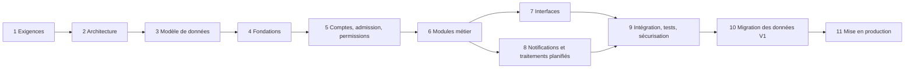

# ClassePulse V2 — Feuille de route de reconstruction

> Ordre logique proposé, fondé sur les dépendances entre modules décrites dans `README.md`. Aucune durée n'est estimée (elle dépend de l'équipe et des décisions Q-01 à Q-15). Pas de tickets détaillés à ce stade.

| # | Étape | Objectif | Principaux livrables | Dépend de |
|---|---|---|---|---|
| 1 | **Finalisation des exigences** | Figer le périmètre V2 | Réponses aux questions Q-01…Q-15 ; statut V2 définitif de chaque F-001…F-080 ; règles C confirmées ou modifiées ; matrice de permissions (D) validée ; critères d'acceptation par fonctionnalité | — |
| 2 | **Décisions d'architecture et choix technologiques** | Choisir une architecture simple répondant aux principes H | Comparaison argumentée des options ; décisions tracées (langage, frameworks, base, authentification, temps réel, traitements planifiés, hébergement, budget) ; schéma d'architecture | 1 (notamment Q-01, Q-02, Q-11, Q-15) |
| 3 | **Conception du modèle de données** | Traduire les entités métier (F) dans le modèle retenu | Modèle de données cible ; contraintes d'intégrité ; règles de conservation et de suppression ; correspondance avec les données V1 (si reprise, Q-14) | 1, 2 |
| 4 | **Fondations du projet** | Pouvoir développer, tester et déployer dès le premier jour | Dépôt structuré par modules ; configuration validée ; environnements développement / préproduction / production ; base locale sans accès à la production ; intégration continue (vérifications, tests) ; migrations versionnées ; journaux structurés | 2, 3 |
| 5 | **Comptes, admission et permissions** | Mettre en place le socle dont tous les modules dépendent | Inscription, connexion, déconnexion, récupération, vérification d'email si décidée (F-002…F-011) ; demandes d'adhésion et décisions (F-012…F-019) ; classes, matières, appartenance, rôles (F-020…F-028) ; service d'autorisation central appliquant la matrice D, testé cas par cas | 4 |
| 6 | **Modules métier** | Reconstruire les fonctionnalités dans l'ordre de leurs dépendances | Devoirs et suivi (F-029…F-039) → ressources (F-043…F-050) → chat et annonces (F-051…F-056) → statistiques (F-069…F-072) → assistant IA (F-061…F-068, en dernier car il lit les autres modules) ; chaque module avec ses règles métier testées | 5 |
| 7 | **Interfaces** | Offrir tous les écrans avec un comportement cohérent | Écrans publics, accueils par rôle, écrans de chaque module, administration ; retours systématiques après action ; confirmations de suppression ; accessibilité et usage mobile | 6 (au fil de l'eau, module par module) |
| 8 | **Notifications et traitements planifiés** | Rendre la plateforme proactive et fiable | Catalogue de notifications (F-057) et centre (F-058…F-060) ; temps réel ; rappels J-3/J-1 avec reprise en cas d'échec (F-040, F-041) ; expiration et règle de conservation des devoirs (F-034, F-035) ; emails et leur suivi (F-017, F-073, F-074) ; préférences si décidées | 6 |
| 9 | **Intégration, tests et sécurisation** | Vérifier le produit complet | Tests de bout en bout des parcours E.1…E.10 ; tests des permissions (accès refusés compris) ; revue de sécurité ; tests de charge des rappels et du chat ; recette fonctionnelle sur la liste F-xxx | 7, 8 |
| 10 | **Migration des données V1** (si décidée, Q-14) | Reprendre l'existant sans perte | Inventaire des données V1 ; scripts de transformation testés sur une copie ; contrôles d'intégrité ; stratégie pour les mots de passe ; plan de bascule et de retour arrière | 3, 9 |
| 11 | **Déploiement et préparation à la production** | Mettre en service de façon maîtrisée | Déploiement automatisé ; sauvegardes avec restauration testée ; supervision et alertes ; documentation d'exploitation ; pilote sur une classe ; bascule puis arrêt de la V1 | 9, 10 |

**Remarque** : pendant toute la reconstruction, la V1 reste en service. Ses défauts de sécurité identifiés dans l'audit (`docs/audit-classepulse/05-securite.md`) devraient être corrigés en parallèle, indépendamment de cette feuille de route.
